<div align="center">

# Agun Panjika · আগুন পঞ্জিকা

### Know your country's fire story.

Spin Earth. Explore NASA observations. Understand the seasons.

**Team KUETaguns** · NASA Space Apps Challenge 2026<br>
*Harmonization of MODIS and VIIRS Hot Spots*

**[Explore the app](https://polymathicx.github.io/Agun-Panjika/)** · **[Watch the 29-second demo](https://polymathicx.github.io/Agun-Panjika/demo/)**<br>
[Seven-slide PDF](docs/pdf/GLOBAL_DEMO_SLIDES.pdf) · [Editable PowerPoint](docs/pptx/GLOBAL_DEMO_SLIDES.pptx) · [Project brief PDF](docs/pdf/PROJECT_BRIEF.pdf) · [Global roadmap PDF](docs/pdf/GLOBAL_EXTENSION_PLAN.pdf)

[](https://github.com/polymathicX/Agun-Panjika/actions/workflows/daily.yml)

[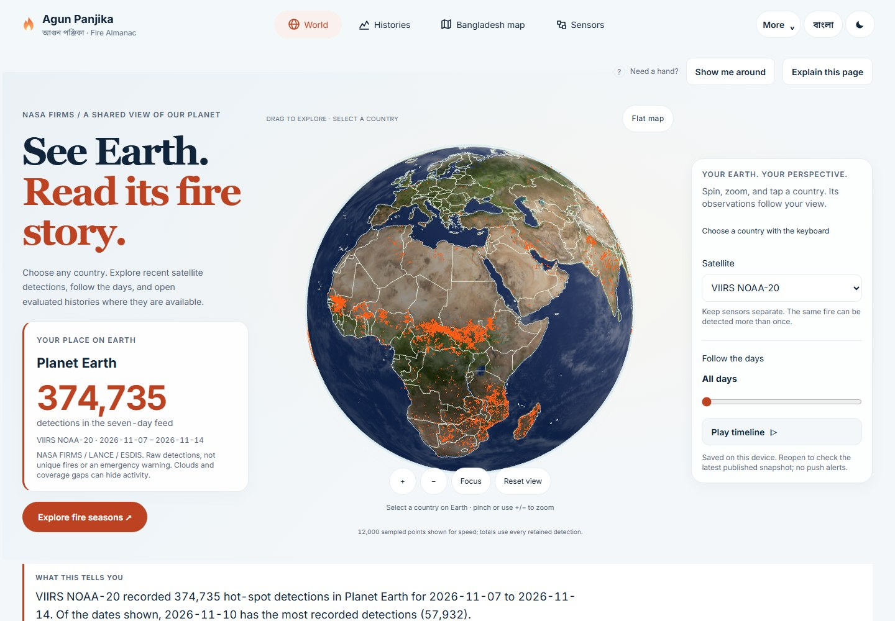](https://polymathicx.github.io/Agun-Panjika/?lang=en&theme=light#/world)

</div>

Agun Panjika is a **Fire Almanac**: a place to explore what satellites observe today and how fire activity changes through the seasons. Choose a country on the Earth, follow its recent observations, and share a dated brief. In four evaluated areas, explore a longer history that connects MODIS and VIIRS measurements on a common detection scale.

Two satellites can see the same landscape differently. MODIS has roughly 1 km active-fire pixels; VIIRS uses 375 m pixels and can detect smaller heat signals. Simply joining their counts can make a change in instrument look like a change in burning. Our historical work makes that correction visible, with the actual reference observations available to check it.

| Worldwide discovery | Historical evidence | Learn at your pace | Take it with you |
| :---: | :---: | :---: | :---: |
| **242** countries and territories | **4** evaluated areas | **85** help topics across **9** pages | Installable **PWA**, dated exports |
| Recent MODIS, NOAA-20 and NOAA-21 observations | Bangladesh, Nepal, Chin, Punjab–Haryana | English and Bangla, optional eight-step introduction | Local watchlist and cached reference pages |

**Documentation updated 15 November 2026.** Screenshots show a real, dated snapshot; the live app displays each feed's own observation window. Worldwide recent observations and the four evaluated historical areas have different scopes.

[Explore](#a-minute-in-the-app) · [Screenshots](#explore-every-view) · [Methods](#how-the-records-connect) · [Downloads](#read-share-or-present) · [Run locally](#run-it-locally) · [All documentation](docs/README.md)

## A minute in the app

1. **Find your place.** Drag the Earth, zoom and tap a country. The view moves to your selection. A keyboard selector and flat map offer other ways to explore.
2. **Follow the days.** Choose a satellite, move the day slider or play the timeline. Read the count, source and dates together.
3. **Understand the pattern.** Read **What this tells you**, then open **How to read this** for its basis. In **Histories**, change the year and sensor-switch week, then reveal actual VIIRS observations.
4. **Keep a useful view.** Watch a country on your device, export a dated PNG/JSON/daily CSV, or install the app for return visits.

Need a hand? **Show me around** teaches the main journey through real actions. **Explain this page** is available on every page: choose any topic, try the highlighted controls and return whenever you want. [Complete user guide](docs/USER_GUIDE.md).

<details>
<summary><b>See the globe move — a five-second recording of the actual app</b></summary>

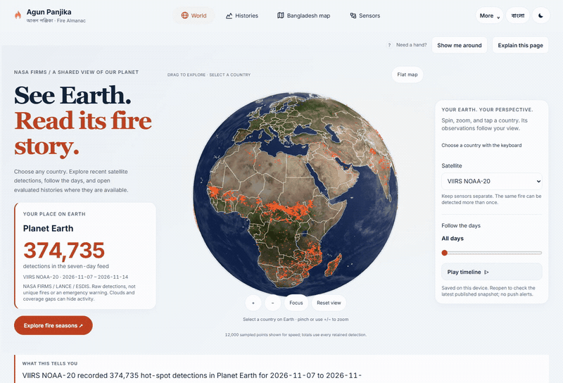

The preview loops. Open the [live Earth](https://polymathicx.github.io/Agun-Panjika/#/world) for touch, zoom, country selection and daily playback. [Full captioned demo](https://polymathicx.github.io/Agun-Panjika/demo/).

</details>

## A place, a season, a useful conversation

| For someone who wants to… | What the app makes possible |
| --- | --- |
| Understand activity near a place they care about | Select a country, compare the dates available and keep a source-linked snapshot |
| Learn how fire seasons vary | Explore weekly calendars, seasonal patterns and a visible MODIS-to-VIIRS comparison |
| Discuss the evidence with others | Share a dated brief that keeps the source, units and interpretation with the numbers |
| Study the method | Reveal reference observations, compare baselines, inspect uncertainty and refit published feature packages |

These are supported tasks and intended benefits. Practitioner testing and measured real-world outcomes are the next research step. The [global roadmap](docs/GLOBAL_EXTENSION_PLAN.md) sets out the evidence needed for wider historical coverage and operational use.

## Explore every view

All images below are **actual app captures**. Click an image to open it at full size; use the view links to try the controls. [Capture dates, routes and reproduction](docs/gallery/README.md).

<table>
<tr>
<td width="50%"><a href="docs/gallery/world.jpg">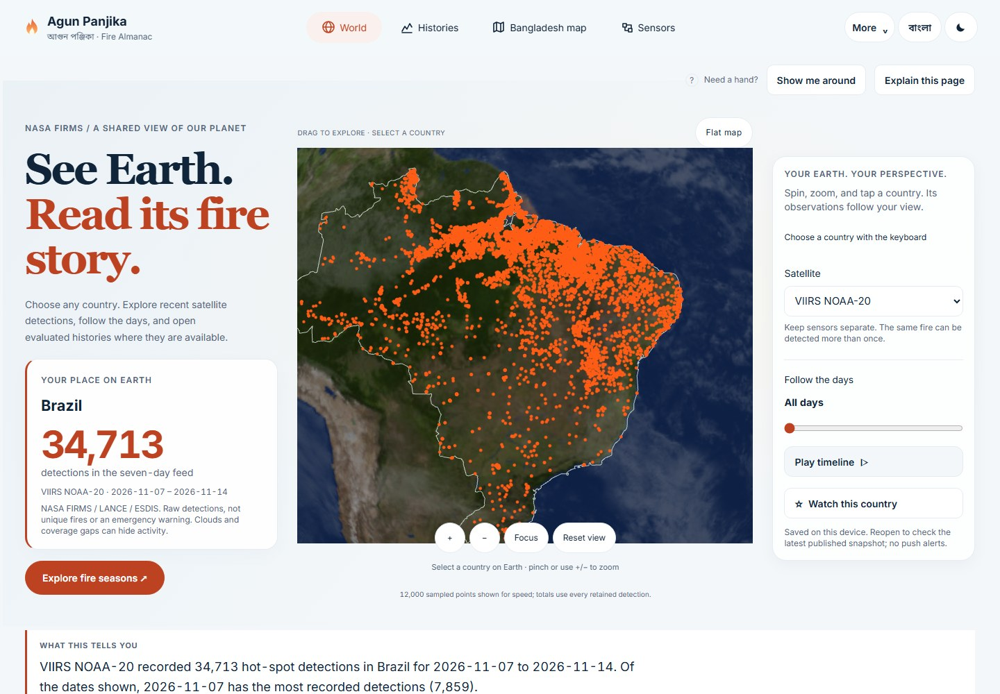</a><br><b>World</b> · <a href="https://polymathicx.github.io/Agun-Panjika/#/world?country=bra">Try a country</a><br>Spin and zoom, compare days, save a place and export its dated observations.</td>
<td width="50%"><a href="docs/gallery/histories.jpg">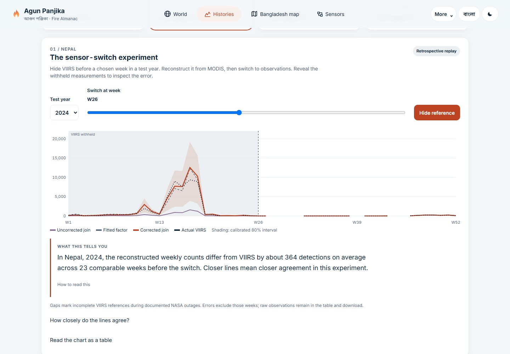</a><br><b>Histories</b> · <a href="https://polymathicx.github.io/Agun-Panjika/#/global?area=nepal&amp;testYear=2024&amp;switchWeek=26&amp;reveal=1">Try the comparison</a><br>Choose an area and year, move the switch and reveal the satellite reference.</td>
</tr>
<tr>
<td><a href="docs/gallery/season-report.jpg">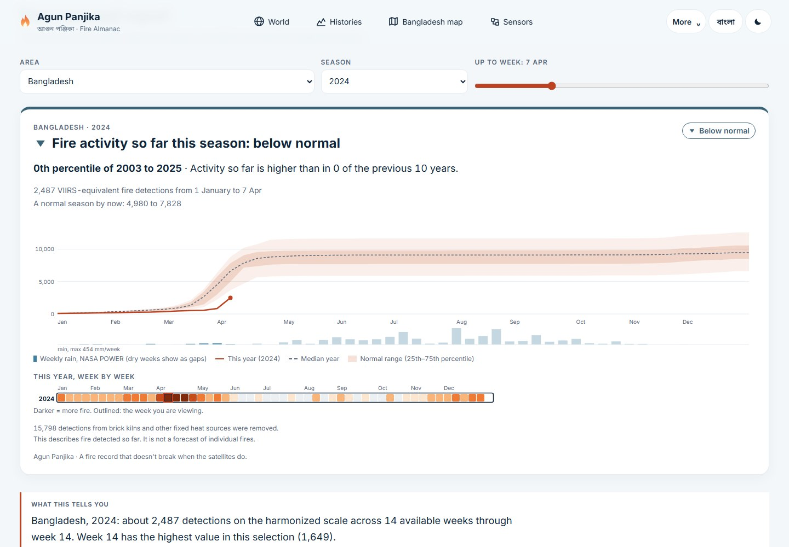</a><br><b>Season report</b> · <a href="https://polymathicx.github.io/Agun-Panjika/#/home?r=bgd&amp;y=2024&amp;w=14">Open report</a><br>Explore the Bangladesh record from 2001 and compare a selected season with its context.</td>
<td><a href="docs/gallery/calendar.jpg">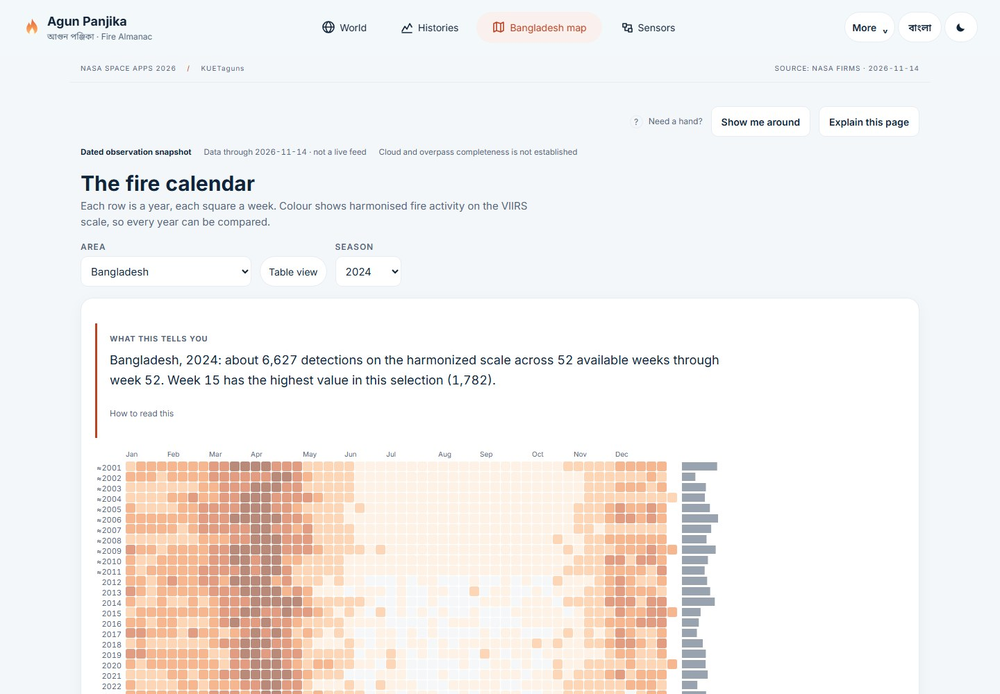</a><br><b>Fire calendar</b> · <a href="https://polymathicx.github.io/Agun-Panjika/#/panjika?r=bgd&amp;y=2024&amp;w=14">Open calendar</a><br>See recurring seasonal patterns and inspect individual weeks.</td>
</tr>
<tr>
<td><a href="docs/gallery/bangladesh-map.jpg">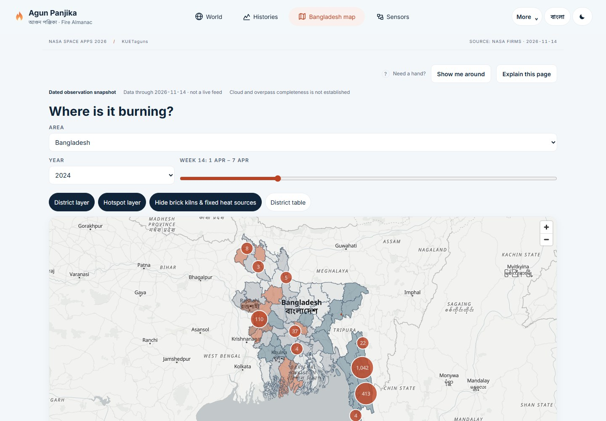</a><br><b>Bangladesh map</b> · <a href="https://polymathicx.github.io/Agun-Panjika/#/map?r=bgd&amp;y=2024&amp;w=14">Explore the map</a><br>Inspect districts and selected-week points alongside the regional record.</td>
<td><a href="docs/gallery/sensors.jpg">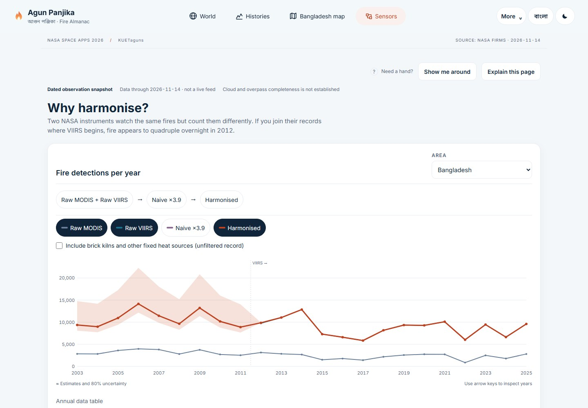</a><br><b>Sensors</b> · <a href="https://polymathicx.github.io/Agun-Panjika/#/sensors?r=bgd">Compare instruments</a><br>See why raw sensor counts differ and inspect the connected series.</td>
</tr>
<tr>
<td><a href="docs/gallery/outlook.jpg">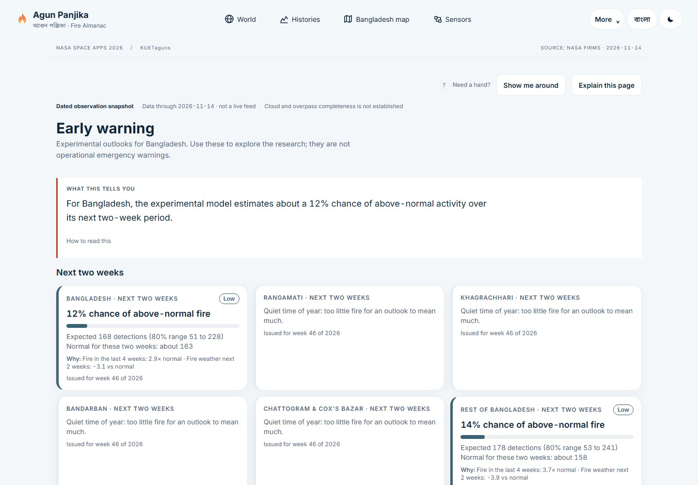</a><br><b>Outlook</b> · <a href="https://polymathicx.github.io/Agun-Panjika/#/outlook?r=bgd">Inspect research outlook</a><br>Read dated experimental estimates, weather context and skill notes. Expired predictions are withheld.</td>
<td><a href="docs/gallery/borders.jpg">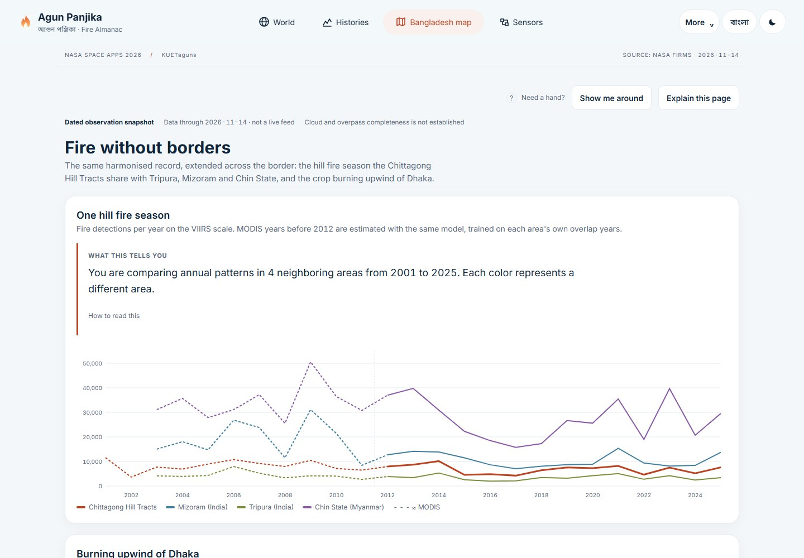</a><br><b>Borders</b> · <a href="https://polymathicx.github.io/Agun-Panjika/#/borders">Explore regional timing</a><br>Compare neighbouring seasonal activity and aerosol context as exploratory evidence.</td>
</tr>
</table>

<details>
<summary><b>Method, downloads and source notes</b></summary>

[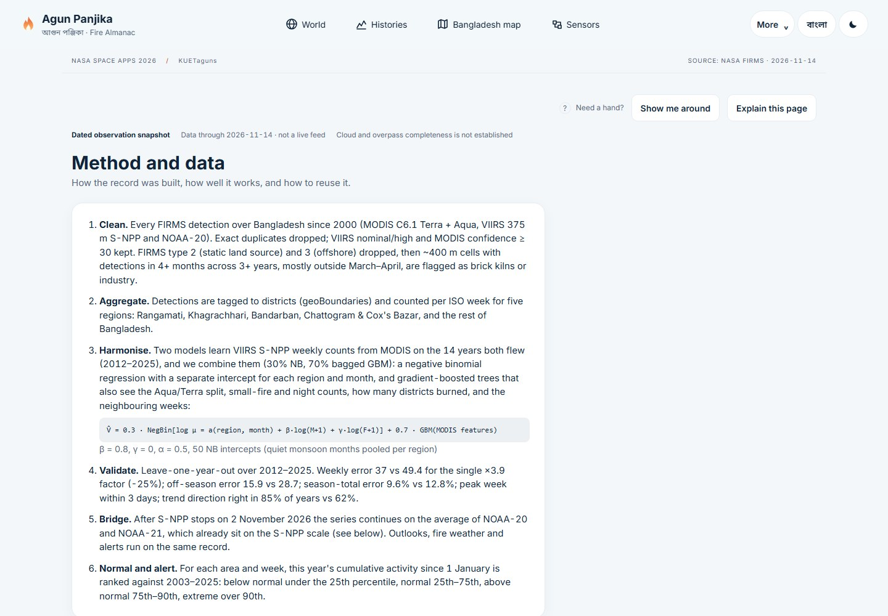](https://polymathicx.github.io/Agun-Panjika/#/method)

**Method** brings the processing explanation, assumptions, source credits and downloadable evidence together. [Open Method](https://polymathicx.github.io/Agun-Panjika/#/method).

</details>

### Built for a return visit

<table><tr>
<td width="33%" align="center">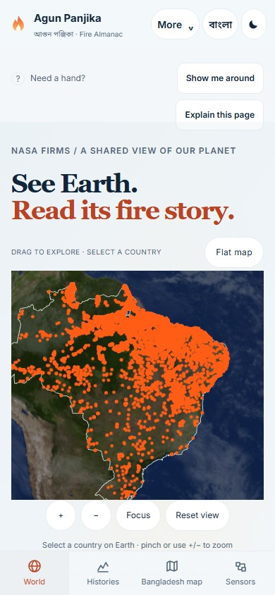</td>
<td width="33%" align="center">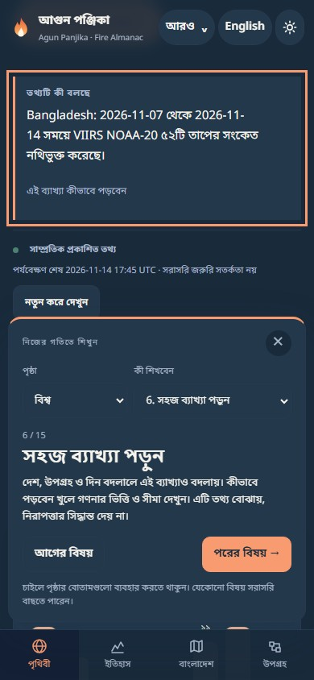</td>
<td width="34%"><b>A country worth keeping close.</b><br><br>Save it locally. Reopen a dated brief. Install through your browser's install or share menu.<br><br>Global summaries and historical reference packages work offline after caching. Country points are cached on visit. Source dates remain visible; new observations and external map tiles need connectivity.<br><br><b>English / বাংলা</b><br>Light and dark themes, reduced motion, keyboard controls, chart tables and help on demand.</td>
</tr></table>

## How the records connect

The recent-data path answers **“What did this satellite observe?”** The historical path asks **“How can we compare the record across a change of instrument?”** Both end in dated, inspectable evidence.

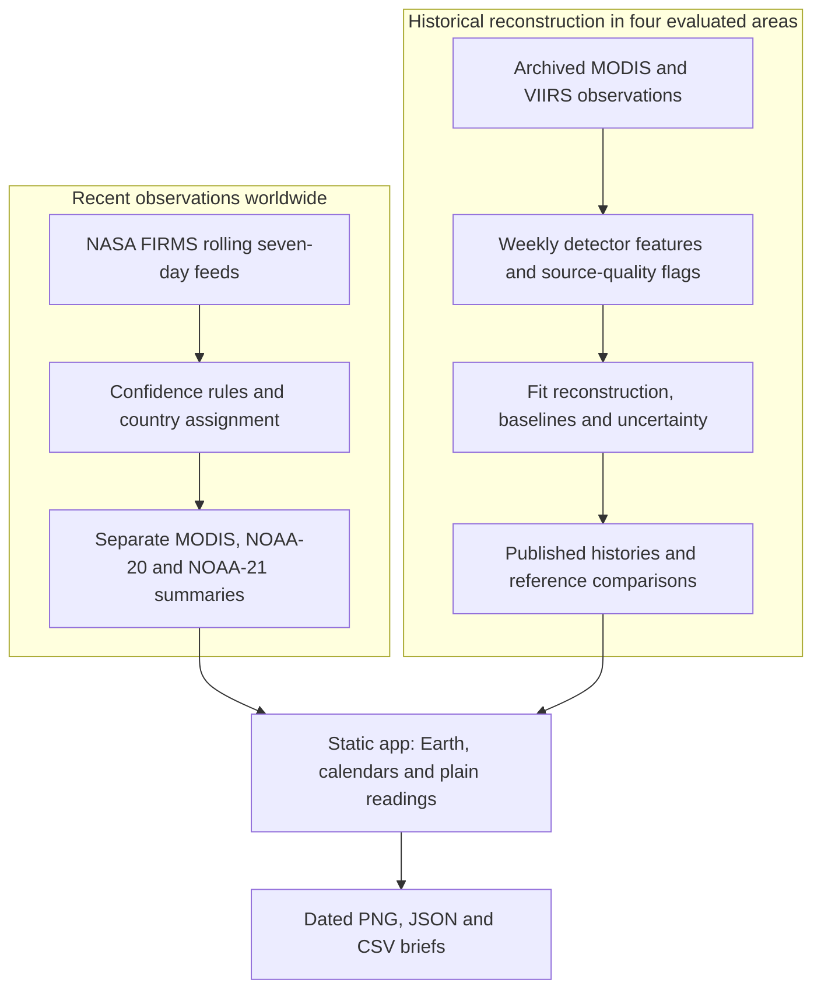

The portable historical model combines negative-binomial regression with five-seed LightGBM. A support guard uses a fitted factor where the tree would exceed its pooled training range. For each target year, fitting and interval calibration use earlier years:

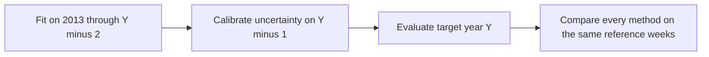

The switch slider changes what the visitor sees; it uses precomputed chronological predictions. The reveal shows how those estimates compare with actual VIIRS. Following-week detector features support retrospective reconstruction. The evaluation years were known during development; independent locked evaluation remains a research gate.

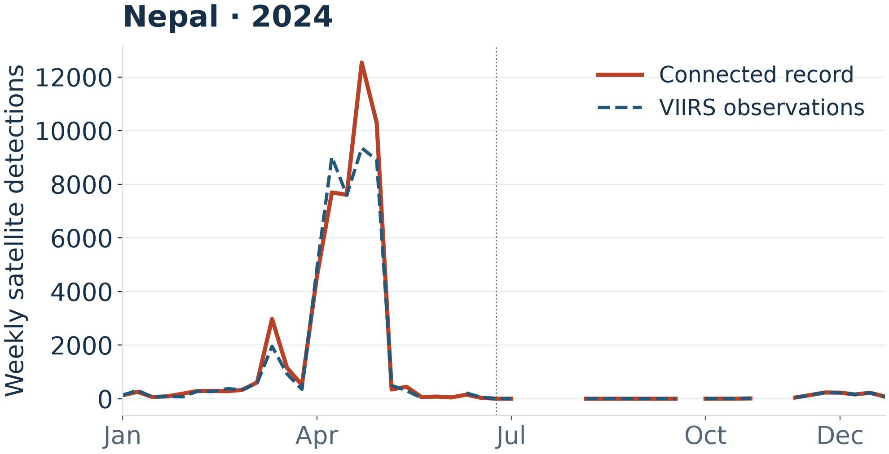

*A Nepal 2024 example.* The connected record uses MODIS-based reconstruction before the selected switch and observed VIIRS afterward. The shading shows the calibrated interval. Gaps preserve incomplete reference weeks. The full [model card](docs/GLOBAL_EVALUATION.md) reports all four areas, raw and comparable weeks, every baseline and measured interval coverage; a monthly-factor baseline is stronger in Chin.

### Read the numbers with their context

| On screen | What it means |
| --- | --- |
| Recent detection count | Retained satellite observations in the displayed feed/window. Repeat observations and industrial heat can occur; this is not a count of unique fires. |
| Points on the Earth | A bounded rendering sample for speed. Totals use every retained detection; static Earth/cloud textures provide geographic context. |
| Reconstructed history | A model estimate on the VIIRS S-NPP detection scale, with uncertainty and source-quality labels. It is distinct from a measurement. |
| “What this tells you” | Fixed calculations from the selected published data. The basis and limits are available beside the reading; no external AI service writes scientific judgments. |
| Missing, zero or stale | Kept distinct. A missing feed or incomplete reference is not silently converted into zero activity. Each snapshot keeps its date. |
| Research outlook | A dated experiment with validity and skill notes. The app supports learning and research; it is not an emergency warning service. |

## Data, sources and reproducibility

| Source | Contribution | Inspect the evidence |
| --- | --- | --- |
| [NASA FIRMS](https://www.earthdata.nasa.gov/data/tools/firms) | MODIS C6.1 and VIIRS fire/hotspot observations; current global feeds use MODIS, NOAA-20 and NOAA-21 | [World summary, windows and hashes](web/public/data/world/summary.json) · [country packages](web/public/data/world/) |
| Historical FIRMS archives | Weekly MODIS/VIIRS features and sensor continuity | [Four-area catalog](web/public/data/global/catalog.json) · [refit-ready features](web/public/data/global/features/) · [quality manifest](web/public/data/global/reference_quality.json) |
| [NASA POWER](https://power.larc.nasa.gov/) | Bangladesh historical weather, fire-weather and aerosol context | [Manifest](web/public/data/manifest.json) · [fire-weather export](web/public/data/fireweather.json) |
| [ESA Fire_cci / CEDA](https://climate.esa.int/en/projects/fire/) | Independent burned-area plausibility context; area and detections are different observables | [Partner comparison](web/public/data/partner.json) · [validation export](web/public/data/validation.json) |
| [Natural Earth](https://www.naturalearthdata.com/) and [geoBoundaries](https://www.geoboundaries.org/) | World and administrative geography | [Country geometry](web/public/data/world/countries.geojson) · [district geometry](web/public/data/districts.geojson) |

[Full sources and asset credits](docs/SOURCES_AND_SUBMISSION.md) · [Data directory guide](docs/DATA_GUIDE.md) · [Model card and reproduction](docs/GLOBAL_EVALUATION.md) · [Assistance disclosure](docs/DATA_AND_AI_DISCLOSURE.md)

## Read, share or present

| You need… | Open or send |
| --- | --- |
| A quick introduction | [29-second captioned demo](https://polymathicx.github.io/Agun-Panjika/demo/) · [seven-slide PDF](docs/pdf/GLOBAL_DEMO_SLIDES.pdf) · [editable PPTX](docs/pptx/GLOBAL_DEMO_SLIDES.pptx) |
| The complete project | [Project brief](docs/PROJECT_BRIEF.md) · [six-page PDF](docs/pdf/PROJECT_BRIEF.pdf) |
| Delivered global features and the research ahead | [Global roadmap](docs/GLOBAL_EXTENSION_PLAN.md) · [five-page PDF](docs/pdf/GLOBAL_EXTENSION_PLAN.pdf) · [delivery checklist](docs/IMPLEMENTATION_STATUS.md) |
| Materials for our mentor | [Reading guide and academic questions](docs/MENTOR_BRIEFING.md) · [short message draft](docs/MENTOR_REPLY.md) |
| A teammate making the video | [Handoff with timed story, links, assets and credits](docs/submission/VIDEO_TEAMMATE_HANDOFF.md) · [narration script](docs/submission/30_SECOND_PITCH.md) |
| A scientific or technical review | [Model card](docs/GLOBAL_EVALUATION.md) · [verification record](docs/VERIFICATION.md) · [source-quality research](docs/MODEL_OPTIMIZATION_RESEARCH.md) |
| To use or maintain the app | [User guide](docs/USER_GUIDE.md) · [development](docs/DEVELOPMENT.md) · [deployment and refresh](docs/DEPLOYMENT.md) |
| Submission copy and presentation sources | [Project-page draft](docs/submission/PROJECT_PAGE_DRAFT.md) · [slides/video build](docs/submission/README.md) · [A4 report build](docs/latex/README.md) |
| Every document, including historical plans | [Complete documentation index](docs/README.md) |

The ready MP4 has baked-in English captions and **no audio**; teammates may record narration while keeping the final video within 30 seconds. The deck has seven slides including title and team credits. The team must review the official project page and perform **Submit for Judging**; GitHub publishing does not submit it.

## Run it locally

**Node.js 22.12+** is enough to view the committed data. From the repository root:

```powershell
cd web
npm ci
npm run dev
```

Open the URL Vite prints. For the production build and offline/PWA checks, run `npm run build`, then `npm run preview -- --host 127.0.0.1 --port 4173 --strictPort`. [Full setup and checks](docs/DEVELOPMENT.md).

To reproduce the four historical experiments from public, checksum-verified feature packages, use **Python 3.11+** from the repository root:

```powershell
python -m pip install -e ".[dev]"
python -m pipeline.global_cases --from-packages
```

This needs no NASA key or raw-data download. It refits the model and evaluation from published aggregates; it does not rebuild raw-to-feature preprocessing. [Scientific reproduction and limits](docs/GLOBAL_EVALUATION.md).

### Publish and keep the snapshot current

The static app is hosted on **GitHub Pages**. Pushes to `main` build and publish committed exports; a six-hour scheduled workflow fetches the global feeds. Manual refresh is available through GitHub Actions. No application server or database is required, and no FIRMS key is sent to the browser.

[Free hosting and refresh guide](docs/DEPLOYMENT.md) · [Publishing workflow](.github/workflows/daily.yml) · [Actions runs](https://github.com/polymathicX/Agun-Panjika/actions)

### What has been checked

The [15 November verification record](docs/VERIFICATION.md) reports **80 Python tests, zero skips**, nine frontend evidence tests, TypeScript/production build checks and 15 browser groups. Its responsive matrix covers 54 route/layout combinations with zero recorded overflow, page/console errors or axe findings. All 85 help topics, real country selection and cached offline access were exercised. PDF page counts, MP4 duration and the editable deck were checked; the PPTX was rendered in Microsoft PowerPoint.

Those are recorded software checks. Physical-phone testing, a participant study and a new independent scientific evaluation remain separate work. [Machine-readable record](docs/review/verification-2026-11-15.json) · [Visual review](docs/review/README.md).

## Repository map

| Location | Contents |
| --- | --- |
| [web/src](web/src/) | React/TypeScript views, Three.js Earth, D3 charts, MapLibre map, help and translations |
| [web/public/data](web/public/data/) | Static scientific/observation packages consumed by the app |
| [pipeline](pipeline/) | Python ingestion, geography, harmonization, quality rules and evaluation |
| [tests](tests/) · [browser checks](web/scripts/upgrade/) | Scientific contracts and actual browser interactions |
| [docs](docs/) | Product/research guides, PDFs, editable deck, presentation sources and review evidence |
| [notebooks](notebooks/) | Supporting research/figure work |
| [Graphify report](graphify-out/GRAPH_REPORT.md) | Generated codebase navigation and relationships |

## Team and credits

**KUETaguns · Bangladesh**

Sohaib Hasan Niloy (Team Owner) · Ayesha Mehereen · Sarwad Hasan Siddiqui · Adiba Tahsin · Abdullah Al Saif · Md. Rafsani Shazid.

We acknowledge NASA's Fire Information for Resource Management System (FIRMS), part of LANCE and ESDIS, for the fire observations. NASA does not endorse this project. Earth/cloud textures are by [Solar System Scope](https://www.solarsystemscope.com/textures/), [CC BY 4.0](https://creativecommons.org/licenses/by/4.0/). Geography, map, data and software credits appear in [Sources](docs/SOURCES_AND_SUBMISSION.md).

AI assisted implementation, review, plotting, documentation and demo assembly. Raw NASA observations remain source measurements; model outputs are labeled estimates. [Disclosure](docs/DATA_AND_AI_DISCLOSURE.md). Original code: [Apache 2.0](LICENSE). Third-party resources retain their own terms: [NOTICE](NOTICE) · [frontend dependency notices](web/public/THIRD_PARTY_NOTICES.txt).
