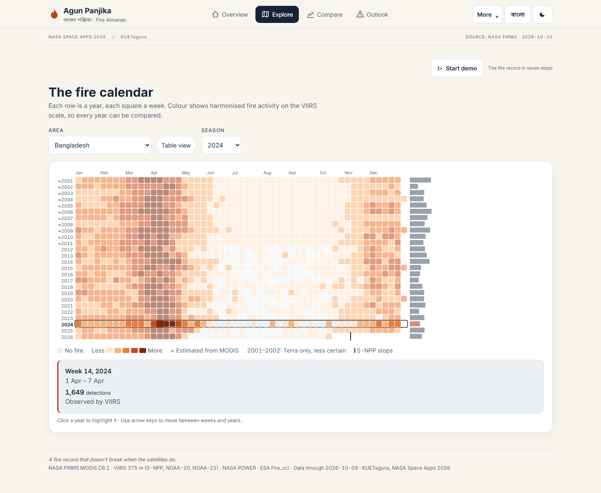
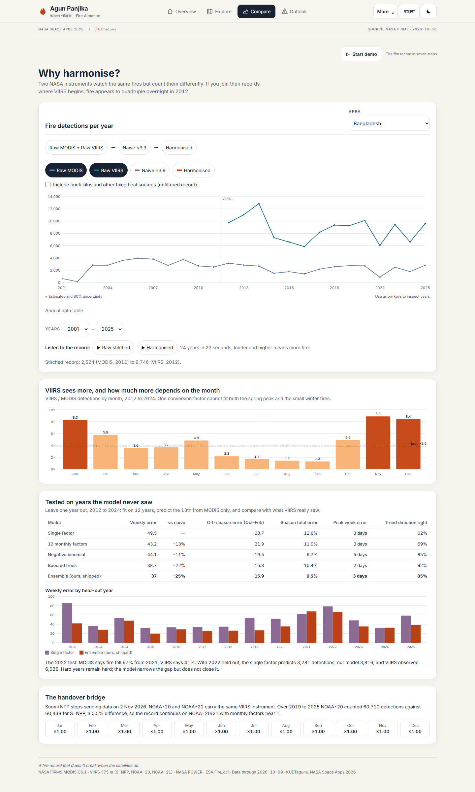
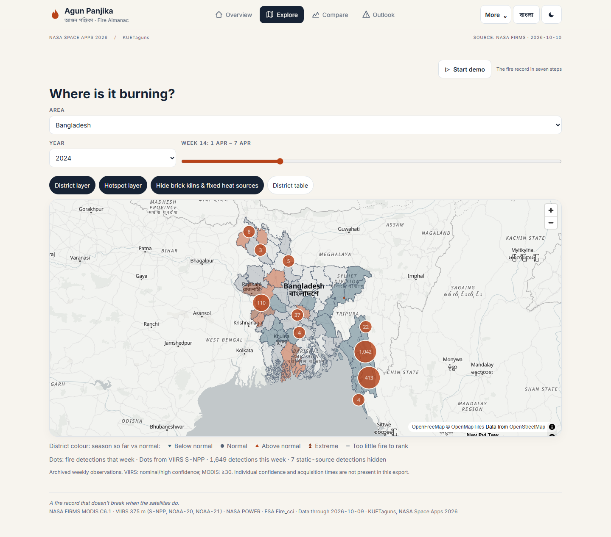
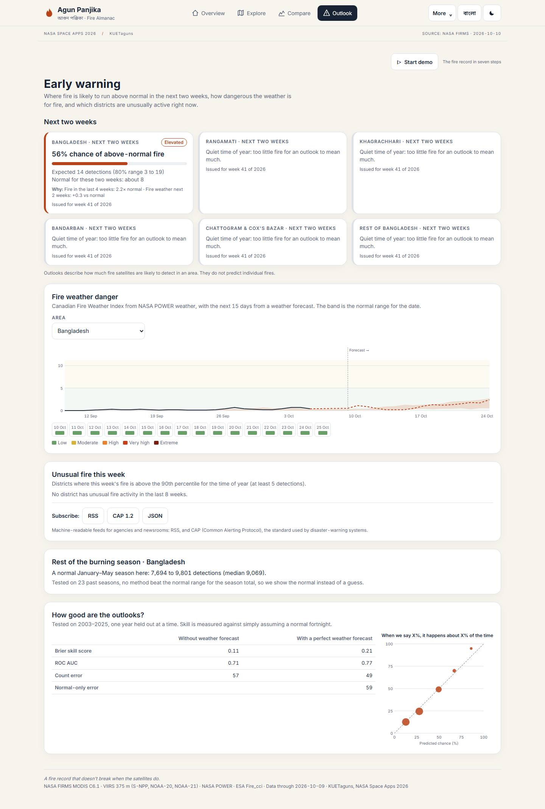
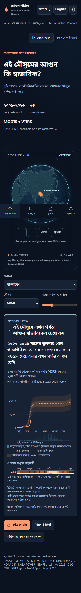
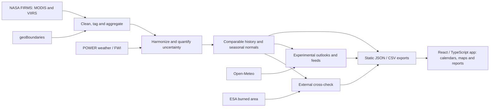
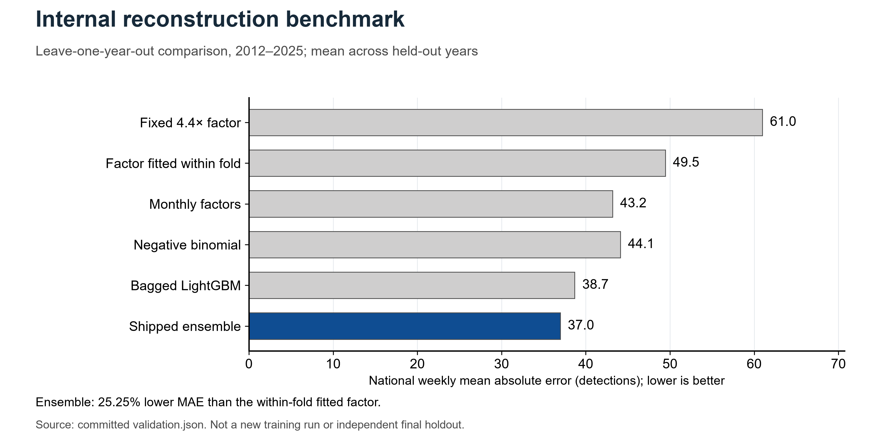
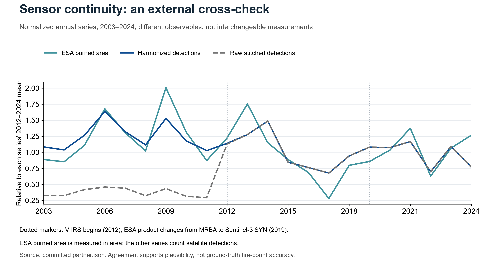

<div align="center">

# Agun Panjika · আগুন পঞ্জিকা

**A comparable fire history. A clearer view of the season.**

Team **KUETaguns** · KUET, Khulna, Bangladesh<br/>
NASA Space Apps Challenge 2026 · *Harmonization of MODIS and VIIRS Hot Spots*

[Project video](https://youtu.be/9FMIzcXhqB4) · [Project brief](docs/PROJECT_BRIEF.md) · [Global extension proposal](docs/GLOBAL_EXTENSION_PLAN.md) · [Academic review guide](docs/MENTOR_BRIEFING.md)


</div>

Agun Panjika (Fire Almanac) helps a user investigate **“Is this fire season normal for this area?”** It combines a Python scientific pipeline with an English/Bangla web application, starting with Bangladesh and the Chittagong Hill Tracts.

MODIS and VIIRS observe fire at different resolutions and sensitivities. Simply joining their counts can make a change of sensor look like a change in burning. We reconstruct earlier observations on a common weekly VIIRS scale, show uncertainty, and connect that history to calendars, maps and seasonal comparisons.

> **Current snapshot · 29 October 2026:** the eight interface upgrades are merged on `main`. The screenshots here are real captures of that implementation. Committed observations end on **9 October 2026**; the saved outlooks are archived examples. A working public deployment has not been verified. The textured Three.js “Soft Earth” belongs to a separate preview and is not the interface shown here.

## Start here

| What you want to understand | Read |
| --- | --- |
| The complete project, methods, results and limits | [Project brief for academic review](docs/PROJECT_BRIEF.md) |
| Where mentorship or research collaboration would help | [Academic review guide](docs/MENTOR_BRIEFING.md) |
| Proposed global-round features and evaluation milestones | [Global extension plan](docs/GLOBAL_EXTENSION_PLAN.md) |
| Statistical concerns and source-level evidence | [Scientific review](docs/SCIENTIFIC_REVIEW.md) |
| What was tested and how to reproduce the checks | [Verification report](docs/VERIFICATION.md) |
| Data sources, credits and supplied competition guidance | [Sources and submission notes](docs/SOURCES_AND_SUBMISSION.md) |
| All documentation, including historical plans | [Documentation index](docs/README.md) |

## What works now

| Capability | Current scope |
| --- | --- |
| Comparable historical record | Weekly VIIRS-scale history from 2001, with observed/estimated provenance and nominal 80% intervals |
| Seasonal context | Cumulative activity against historical normals for Bangladesh, five analysis regions and 64 districts |
| Fire calendar | Interactive year/week heatmap, keyboard inspection, table alternative and local CHT calendars |
| Sensor comparison | Raw observations, a scaling baseline, harmonized history, monthly ratios, validation and sonification |
| Geographic exploration | Archived FIRMS coordinates, district choropleth, clusters, static-source controls and an interactive Canvas sphere with 2D mode |
| Local calendars | 25 upazilas and 124 unions across Rangamati, Khagrachhari and Bandarban; historical values include apportioned estimates |
| Experimental outlooks | Two-week national/regional activity outlooks, fire-weather views and district anomaly feeds; operational performance remains unverified |
| Cross-border context | CHT and neighbouring areas; upwind burning beside Dhaka aerosol timing, without causal smoke attribution |
| Access and reporting | English/Bangla, light/dark themes, mobile layouts, CSV/PNG/print outputs, guided demo and cached offline resources |

The users are intended forest officers, communities, researchers and newsrooms. **A completed field pilot, agency adoption and measured prevention benefits have not yet been established.**

## See the application

These production-build captures were made on 29 October 2026 from the current application, using the committed data snapshot. A screenshot of an outlook or map is not a live-data claim.

<table>
<tr>
<td width="50%"><br/><b>Calendar</b> · Compare seasons and inspect a selected week.</td>
<td width="50%"><br/><b>Sensors</b> · See how instrument differences affect the record.</td>
</tr>
<tr>
<td><br/><b>Map</b> · Explore district patterns and archived observations.</td>
<td><br/><b>Outlook</b> · Inspect experimental activity and weather products.</td>
</tr>
</table>

<details>
<summary><b>Mobile Bangla and dark-theme overview</b></summary>

<p align="center"></p>

The UI is bilingual; union place names are not yet fully localized. Offline use requires previously cached same-origin resources, and external fonts/map tiles may be unavailable.

</details>

[Capture provenance and full-size images](docs/review/README.md) · [Watch the team's project video](https://youtu.be/9FMIzcXhqB4)

## Scientific methodology

The pipeline cleans and geographically tags FIRMS observations, applies confidence/static-source filters, aggregates to region-week records and learns a mapping to S-NPP counts during the **2012–2025 overlap**. The shipped ensemble combines **30% negative-binomial regression and 70% bagged Poisson LightGBM**, averaged over five seeds. A separate Terra-only reconstruction covers the earliest period.



This is a retrospective reconstruction: some model features use neighbouring weeks, including the following week's MODIS activity. It should not be described as an issue-time prediction method.

### Internal results



| Result | Scope and source |
| --- | --- |
| Weekly national MAE **36.964**, versus **49.450** for a fitted factor | About **25% lower error** in the internal 2012–2025 leave-one-year-out comparison; [validation JSON](web/public/data/validation.json) |
| **81.3%** national-week interval coverage for an 80% target | Current empirical check; strictly independent nested calibration is still needed |
| ESA transition diagnostic **0.95** harmonized versus **3.09** raw stitched | Aggregate plausibility check against a different observable; [partner JSON](web/public/data/partner.json) |
| NOAA-20 **4.58%**, NOAA-21 **10.79%** mean absolute held-out total error | Selected identity bridge, differing overlap lengths; [bridge JSON](web/public/data/bridge.json) |

These are **saved internal evaluation results**, not a new training run, independent final validation or operational forecast accuracy. The model is not best on every metric or in every region. [Complete comparisons and limitations](docs/PROJECT_BRIEF.md#5-results-and-what-they-establish)



Burned area and detection counts measure different phenomena. The normalized plot checks broad continuity and variability; it does not prove that every fire was detected or that all sensor bias was removed. [Figure sources, captions and vector downloads](docs/review/README.md)

### What remains uncertain

- Earlier history is reconstructed. Terra-only years have lower confidence; small-area estimates are apportioned rather than independently fitted.
- The current uncertainty check is not strictly nested, and model/feature selection needs an untouched final holdout.
- Weather-assisted hindcast skill uses observed future FWI as an optimistic experiment. It is not operational weather-forecast performance; no season-total skill is claimed.
- Static-source filtering is a tuned heuristic with small manual image samples, not a validated inventory of industrial facilities.
- Missing sensor coverage, data freshness and handover behavior need stronger checks across all exports.
- No individual-fire ignition prediction, causal smoke-arrival model, field-tested warning service or globally validated accuracy is claimed.

[Source-level scientific review](docs/SCIENTIFIC_REVIEW.md) · [Proposed research and user-validation work](docs/GLOBAL_EXTENSION_PLAN.md)

## Proposed global extension

The next proposed direction is **comparable fire calendars across independently evaluated areas**, with an inspectable sensor-transition comparison and a dated evidence report. Begin with Bangladesh, reproduce Nepal, and choose a contrasting third setting with a domain reviewer. Each case should publish baselines, coverage, uncertainty and failures.

The first release would use supported area packages. Arbitrary polygons require additional processing and area-specific validation; drawing a polygon around existing map points does not make a calibrated history for that area. Low-data cases should explain their limits rather than display false precision.

The proposal also prioritizes a reliable public demo, stronger independent evaluation, a small practitioner/user study and a focused global submission. These features are **planned, not implemented**. [Read the roadmap and acceptance criteria](docs/GLOBAL_EXTENSION_PLAN.md).

## Getting started

**Frontend:** Node.js 20+ and npm. The committed exports are sufficient; a FIRMS key is not needed to inspect the interface.

```sh
git clone https://github.com/polymathicX/Agun-Panjika.git
cd Agun-Panjika/web
npm ci
npm run dev
```

For a production preview, run from `web/`:

```sh
npm run typecheck
npm run build
npm run preview -- --host 127.0.0.1 --port 4173 --strictPort
```

**Python:** Python 3.11+. From the repository root, create and activate a virtual environment using your shell, then:

```sh
python -m pip install -e ".[dev]"
python -m pytest -q
python -m pipeline.run_all --help
```

To regenerate scientific outputs, `python -m pipeline.run_all` downloads archive inputs and fits the pipeline. For API backfill and cross-border products:

```sh
python -m pipeline.run_all --api-since 2025-01-01 --neighbours
```

Fresh FIRMS API requests need `FIRMS_MAP_KEY` in the gitignored root `.env` or process environment. Preserve any existing environment configuration. Keep credentials on the pipeline side. Full regeneration can download substantial datasets and rewrite exports; ordinary interface review does not require it.

For a Nepal build in PowerShell:

```powershell
$env:AP_COUNTRY = "pipeline/countries/npl.json"
python -m pipeline.run_all
Remove-Item Env:AP_COUNTRY
```

Other-country outputs are isolated in country-specific `data/` and `build/` folders. Configuration support alone does not establish scientific transfer performance.

[Browser-test commands, scientific reproduction and review-figure generation](docs/VERIFICATION.md)

## Verification and release status

On **29 October 2026**, the current code passed **59 Python tests**, TypeScript checking, the production build and **10 production browser test groups**. The 42-view matrix recorded no page/console errors, page overflow or axe findings. Those checks do not replace physical-device, assistive-technology, field-user or prospective scientific evaluation. [Recorded evidence](docs/review/verification-2026-10-29.json)

The existing daily workflow is configured to refresh and deploy through GitHub Pages, but recent hosted refreshes failed at the pipeline step. A local pass does not establish a successful hosted deployment. Check [Actions](https://github.com/polymathicX/Agun-Panjika/actions) for subsequent runs. Dependency advisories, source licensing and in-app method-copy drift are also tracked as follow-up work. [Verification and known limits](docs/VERIFICATION.md)

## Repository map

```text
pipeline/             Ingest, filtering, geography, models, weather, exports
web/src/              React screens, charts, maps, language and state
web/public/data/      Committed scientific exports and feeds
notebooks/            Validation notebook and reproducible figure scripts
tests/                Scientific, forecast, schema and contrast checks
docs/                 Project brief, roadmap, review and historical plans
docs/review/          Current screenshots, figures and verification evidence
graphify-out/         Code relationship graph and architecture report
.github/workflows/    Refresh/build/deploy workflow
```

## Data sources, credits and citation

The project uses [NASA FIRMS](https://firms.modaps.eosdis.nasa.gov/), [NASA POWER](https://power.larc.nasa.gov/), [ESA Fire_cci](https://climate.esa.int/en/projects/fire/), [geoBoundaries](https://www.geoboundaries.org/), [Open-Meteo](https://open-meteo.com/) and [NOAA CPC](https://www.cpc.ncep.noaa.gov/products/analysis_monitoring/ensostuff/ensoyears.shtml). Map attribution includes OpenFreeMap/OpenMapTiles/OpenStreetMap. Static-source inspection imagery credits include Esri, Maxar and Earthstar Geographics. [Full credits and sources](docs/SOURCES_AND_SUBMISSION.md)

A project-wide software license has not yet been selected in this repository; source availability should not be treated as a license grant. Source datasets, imagery and libraries retain their own terms and attribution requirements.

```text
KUETaguns (2026). Agun Panjika: a harmonized MODIS and VIIRS fire record
and bilingual fire almanac for Bangladesh, 2001 onward.
NASA Space Apps Challenge 2026. Data snapshot through 9 October 2026.
https://github.com/polymathicX/Agun-Panjika
```
