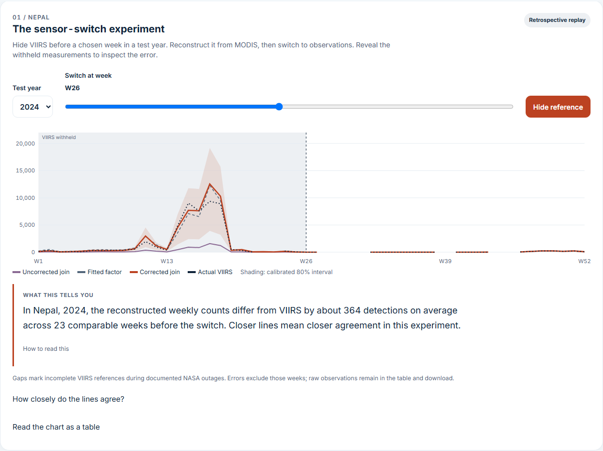
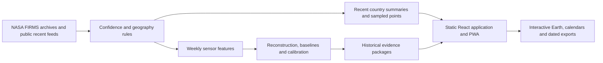

<div align="center">

# Agun Panjika · আগুন পঞ্জিকা

**Know your country's fire story.**

Team **KUETaguns** · NASA Space Apps Challenge 2026<br>
*Harmonization of MODIS and VIIRS Hot Spots*

[Open the app](https://polymathicx.github.io/Agun-Panjika/) · [29-second demo](https://polymathicx.github.io/Agun-Panjika/demo/) · [Seven slides](docs/pdf/GLOBAL_DEMO_SLIDES.pdf) · [Editable PowerPoint](docs/pptx/GLOBAL_DEMO_SLIDES.pptx)

[Project brief PDF](docs/pdf/PROJECT_BRIEF.pdf) · [Global roadmap PDF](docs/pdf/GLOBAL_EXTENSION_PLAN.pdf) · [Model card](docs/GLOBAL_EVALUATION.md) · [Mentor reading guide](docs/MENTOR_BRIEFING.md)

[Video teammate handoff: story, recording links and assets](docs/submission/VIDEO_TEAMMATE_HANDOFF.md)


</div>

Agun Panjika brings two questions together: **What are satellites observing in my country now?** And **how can we compare fire activity when the observing instruments change?** Spin the Earth, zoom in and tap a country. Then inspect a dated observation brief or explore a historical calendar whose sensor correction can be checked against real VIIRS measurements.

MODIS and VIIRS have different resolutions and sensitivities. Joining raw counts can make a change of instrument look like a change in burning. Our historical pipeline estimates earlier weekly activity on a VIIRS S-NPP detection scale and keeps observations, estimates and uncertainty distinguishable.

> **15 November 2026 release:** recent observations cover **242 Natural Earth countries and territories**, with MODIS, NOAA-20 and NOAA-21 kept separate. Historical reconstruction is evaluated in **four South Asian areas**, not worldwide. The Soft Earth design remains. Static Earth/cloud textures are geographic context, not live weather. The app shows each feed's observation window and flags stale snapshots.

## Start with a place

First visit? Choose **Show me around** for the optional eight-step introduction. For detailed help, open **Explain this page** anywhere: 85 English/Bangla topics cover all nine pages, with real controls highlighted and any topic available on demand.

1. **Spin, zoom and tap.** Explore recent observations on a textured 3D Earth. No country search is needed; keyboard selection and a flat map are available as alternatives.
2. **Read the source.** Change the satellite or day, play the timeline and inspect the country's counts. Detections are not unique fires; repeat observations and industrial heat can remain.
3. **Keep the evidence.** Save a country locally, export its dated PNG/JSON/daily CSV, or open a supported historical case and reveal the reference observations.
4. **Return on a phone.** Install the PWA through the browser's install/share menu. Global summaries and historical cases work offline after installation; country points are cached on visit. New observations and external map tiles need connectivity.

<table><tr>
<td width="67%"><br><b>Inspect the correction.</b> Choose a test year, move the sensor-switch week and reveal VIIRS.</td>
<td><br><b>Keep a country close.</b> Local watchlist, dated reports and cached reference data.</td>
</tr></table>

## What the project delivers

| Capability | Scope and interpretation |
| --- | --- |
| Worldwide observations | Recent seven-day NASA FIRMS feeds; 242 country/territory summaries, daily playback, per-satellite totals, source timestamps and SHA-256 provenance |
| Historical evidence workbench | Bangladesh, Nepal, Chin in Myanmar, and Punjab–Haryana in India; annual past-only temporal experiments, full baselines, interval coverage, source-quality flags, calendars and exports |
| Bangladesh fire almanac | Weekly history from 2001, five analysis regions, 64 districts, seasonal normals, local CHT calendars, maps and sensor comparisons |
| Successor continuity | Shared monthly correction and handover/outage rules for main/local/neighbour series; actual zero and missing source stay distinct |
| Experimental research views | Two-week outlooks, fire-weather context, ESA burned-area comparison and cross-border/aerosol timing; expired outlooks are suppressed |
| Access | English/Bangla, light/dark themes, reduced motion, keyboard/table alternatives, responsive layout and installable PWA |
| Public evidence | Refit-ready feature files, model card, academic briefs, seven-slide deck, 29-second captioned demo and submission-page draft |

The intended benefit is easier access to comparable fire-season evidence for students, communities, researchers and land managers. **A practitioner pilot, adoption and measured prevention benefits have not been established.** This is a research and communication prototype, not an emergency warning service.

## Why connect the satellite records?

MODIS sees larger pixels than VIIRS. A finer sensor can detect smaller heat signals, so raw counts from the two instruments tell different stories. Agun Panjika reconstructs the earlier record on a common scale so people can explore fire seasons across that change.

In **Histories**, choose Bangladesh, Nepal, Chin or Punjab–Haryana. Pick a year, move the satellite-switch week, and reveal the real VIIRS observations. The calendar shows the longer seasonal pattern. Estimates, observations and uncertainty remain labeled.

**What this tells you** explains the current selection in ordinary words. It follows the country, satellite, day or historical year shown on screen. Open **How to read this** to see its calculation basis and limits. These are fixed calculations from the published data, with no AI-generated scientific claims or external AI service.

For a deeper check, the [model card](docs/GLOBAL_EVALUATION.md) gives the complete current-method comparisons, source-quality flags, uncertainty coverage and reproducible inputs. Worldwide recent observations and four evaluated historical areas have different scopes.

## Run locally

Frontend: **Node.js 22.12+**. Python is unnecessary to view committed exports.

```powershell
cd web
npm ci
npm run dev
```

Open the URL Vite prints. For a production/PWA check, run `npm run build`, then `npm run preview -- --host 127.0.0.1 --port 4173 --strictPort`. PWA installation requires HTTPS or localhost. The browser receives no FIRMS secret.

Python: **3.11+**. From the repository root:

```powershell
python -m pip install -e ".[dev]"
python -m pipeline.global_cases --from-packages
python -m pytest -q
python -m ruff check pipeline tests
```

`--from-packages` refits all four experiments from checksum-verified public feature CSVs without downloading raw observations or using a key. It does not independently rebuild the raw-to-feature preprocessing. Numerical differences between library/platform versions remain possible. [Complete reproduction and checks](docs/VERIFICATION.md).

## Refresh and free hosting

The app is a static site on **GitHub Pages**. `.github/workflows/daily.yml` publishes pushes to `main`. Its six-hour schedule refreshes worldwide public feeds; **Actions → Publish app and refresh NASA observations → Run workflow → refresh_data** also refreshes them. The first hosted global refresh and deployment succeeded on 14 November ([run](https://github.com/polymathicX/Agun-Panjika/actions/runs/43594804856)). Failed data retrieval fails explicitly; ordinary code publishing does not depend on retraining the science pipeline.

```powershell
python -m pipeline.world_snapshot
# Or reproduce the locally cached source snapshot:
python -m pipeline.world_snapshot --cached
```

Bangladesh/scientific regeneration is a separate, heavier process: `python -m pipeline.run_all --help`. Store optional `FIRMS_MAP_KEY` only in the ignored root `.env` or CI secrets. Raw/intermediate files are ignored. Feature fixtures and browser exports are public. Scheduled builds may serve newer recent observations than the committed repository snapshot.

## How it is built



`pipeline/` contains ingestion, geography, aggregation and evaluation. `web/` contains React/TypeScript, Three.js, D3, MapLibre and the service worker. `web/public/data/` is the export contract. `tests/` and `web/scripts/upgrade/` verify scientific and browser behavior. `docs/` contains the mentor and submission package. [Graphify map](graphify-out/GRAPH_REPORT.md).

## Read, review or present

| Material | Purpose |
| --- | --- |
| [Project brief](docs/PROJECT_BRIEF.md) · [PDF](docs/pdf/PROJECT_BRIEF.pdf) | Complete product, methods, sources, results, architecture and limits |
| [Global roadmap](docs/GLOBAL_EXTENSION_PLAN.md) · [PDF](docs/pdf/GLOBAL_EXTENSION_PLAN.pdf) | Delivered extensions, remaining research and acceptance criteria |
| [Model card](docs/GLOBAL_EVALUATION.md) | Reproducible protocol and complete failure reporting |
| [Mentor guide](docs/MENTOR_BRIEFING.md) | Reading order and concrete academic questions |
| [Verification](docs/VERIFICATION.md) | Executed checks, deployment evidence and reproduction |
| [29-second demo](https://polymathicx.github.io/Agun-Panjika/demo/) · [seven-slide PDF](docs/pdf/GLOBAL_DEMO_SLIDES.pdf) | English demo alternatives; submit one compliant demo format |
| [Project-page draft](docs/submission/PROJECT_PAGE_DRAFT.md) | Submission fields, team, data sources and assistance statement |
| [Sources and credits](docs/SOURCES_AND_SUBMISSION.md) · [AI disclosure](docs/DATA_AND_AI_DISCLOSURE.md) | Judge-visible provenance, software and assistance acknowledgments |
| [Implementation status](docs/IMPLEMENTATION_STATUS.md) · [all documents](docs/README.md) | Delivery record and original plans |

The [older 2:42 local video](https://youtu.be/9FMIzcXhqB4) remains background material; it is not the compliant global short demo. The team must review the project page, confirm membership and click **Submit for Judging** in the official interface. Publishing this repository does not perform that submission.

## Team and credits

**Sohaib Hasan Niloy** (Team Owner), **Ayesha Mehereen**, **Sarwad Hasan Siddiqui**, **Adiba Tahsin**, **Abdullah Al Saif**, **Md. Rafsani Shazid**. KUETaguns, Bangladesh.

We acknowledge NASA FIRMS, part of LANCE and ESDIS, for the fire observations. NASA POWER, ESA Fire_cci, geoBoundaries, Natural Earth and other credited sources support the research/geography. Earth/cloud textures: [Solar System Scope](https://www.solarsystemscope.com/textures/), [CC BY 4.0](https://creativecommons.org/licenses/by/4.0/). NASA does not endorse this project. [Full attribution](docs/SOURCES_AND_SUBMISSION.md).

AI assisted implementation, review, plotting, editorial work and demo assembly. NASA observations remain measured source data; NB/LightGBM outputs are labeled estimates. [Disclosure](docs/DATA_AND_AI_DISCLOSURE.md). Original code is [Apache 2.0](LICENSE); third-party assets retain their terms ([NOTICE](NOTICE), [dependency notices](web/public/THIRD_PARTY_NOTICES.txt)).
