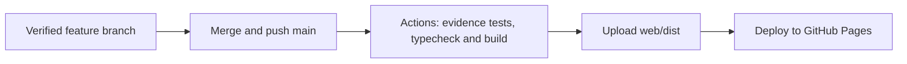

# Free hosting and data refresh

**15 November 2026** · [Live app](https://polymathicx.github.io/Agun-Panjika/) · [Workflow](../.github/workflows/daily.yml) · [Development](DEVELOPMENT.md)

Agun Panjika already runs on **GitHub Pages**, using the public repository and GitHub Actions. The app consists of static files; viewing it needs no application server, database or paid API. Public repositories can use Pages on GitHub Free. [GitHub's official publishing instructions](https://docs.github.com/en/pages/getting-started-with-github-pages/configuring-a-publishing-source-for-your-github-pages-site).

## Publish this repository

The configured route is:

1. In repository **Settings → Pages**, the build source is **GitHub Actions**. The existing `.github/workflows/daily.yml` owns publication; do not add a competing deployment workflow.
2. Merge verified work and push `main`. **Actions → Publish app and refresh NASA observations** shows the build/deploy result.
3. Open the published URL and check the actual source window, country selection, historical reference, demo and downloads. A green build alone does not establish that every browser interaction works.

The production build is `cd web`, `npm ci`, `npm run build`; the publish directory is **`web/dist`**. Vite's default relative base (`./`) supports this repository's `/Agun-Panjika/` path. If using a different host, retain that behavior or deliberately configure `BASE` and check asset/data URLs on the target path. HTTPS is required for installed PWA access outside localhost.

## Refresh the global observations

The workflow's schedule is **00:00, 06:00, 12:00 and 18:00 UTC** (`0 */6 * * *`). Scheduled runs are subject to GitHub availability/delay; the app's source dates are the freshness check. A schedule is not a promise of a new observation at that exact time.

For a manual update:

1. Open **Actions → Publish app and refresh NASA observations → Run workflow** on `main`.
2. Enable **refresh_data**. Leave **full_science** off for an ordinary global update.
3. Run and inspect the data-fetch, scientific-check, build and deploy steps. Open the app and check the displayed windows.

`pipeline.world_snapshot` reads the separate public seven-day MODIS, NOAA-20 and NOAA-21 feeds. This route does not need a FIRMS key. Retrieval failure fails explicitly instead of publishing a silent zero.

Scheduled/manual refresh regenerates data inside the deployment job; it **does not commit those generated files back to Git**. The deployed source windows can therefore be newer than the committed snapshot or README screenshots. An ordinary push without refresh publishes committed exports again. To publish newer committed data, regenerate locally, review and commit it, or run a fresh data-enabled workflow after the push.

## Full scientific regeneration

The optional **full_science** input rebuilds Bangladesh history/weather/outlooks and neighbours, then refreshes worldwide observations. It needs the repository Actions secret **FIRMS_MAP_KEY**, upstream connectivity and heavier scientific downloads. It is separate from normal code publishing and from public historical feature-package reproduction.

Store the key only as an Actions secret or in the ignored root `.env` for local pipeline use. No browser variable or public artifact should contain it. The workflow grants read access to repository contents and the Pages/OIDC permissions required to deploy; it does not need write access to commit data.

The [verification record](VERIFICATION.md) records a successful hosted global refresh. It does not claim the heavier full-science branch has been reverified in that same run.

## Check a deployment

- World: choose a country, satellite and date; confirm count, source window and plain reading agree.
- Histories: choose an area/year and reveal VIIRS; inspect the reference and quality gaps.
- PWA: install/cached access on a supported browser, then revisit a cached page offline; retain original dates.
- Presentation: open the [demo](https://polymathicx.github.io/Agun-Panjika/demo/), MP4, slide PDF and PowerPoint without login.
- Evidence: inspect Actions logs plus [recorded browser checks](VERIFICATION.md); keep physical-device and user-study evidence separate.

For an unexpected old page, first compare its source date with the latest successful workflow. The app deliberately supports cached offline content. If a service-worker problem is suspected, reproduce it in a fresh browser context before clearing someone's site data, which would remove their local watchlist and cache.
