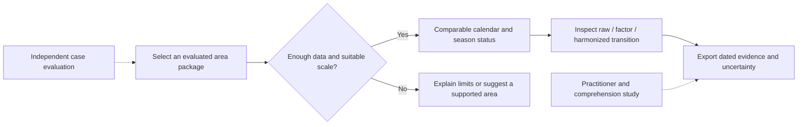

# Proposed global extension and evidence plan

Prepared 29 October 2026 (Asia/Dhaka). This proposal builds on the reviewed prototype. Extensions below are future work, with evidence required before claiming them as delivered. The purpose is a stronger, useful and defensible submission; an award cannot be guaranteed.

## Product direction

Make Agun Panjika a fire calendar whose users can inspect whether a change in apparent activity survives a change in satellite sensor. Prove the method in several contrasting settings, rather than calling the Bangladesh model globally valid because the interface displays a globe.

The central journey is: choose a supported area and period, compare activity with its historical normal, inspect sensor/coverage effects and uncertainty, then share a dated report. A useful result can include an explicit statement that there is insufficient evidence to compare a period reliably.

This extends the current scientific contribution and the actual challenge. It is more defensible than adding unrelated prediction, smoke-arrival, chatbot or visual effects without supporting evidence. The app already contains a geographic sphere, maps, seven screens, sonification, bilingual views, alerts and a guided tour; another presentation feature alone does little to establish new scientific or practical value.

## Proposed user and evidence workflow

The proposed differentiator is inspectable comparability across evaluated areas, including an honest insufficient-evidence state. A global map alone does not supply that evidence.

## Present foundation

- Bangladesh record from 2001 through the checked-in observations of 9 October 2026.
- Five regions, 64 districts, and CHT local calendars for 25 upazilas and 124 unions.
- MODIS reconstruction using a 30% negative-binomial / 70% bagged LightGBM ensemble; internal leave-one-year-out comparisons over 2012–2025.
- Current reported national weekly MAE: 36.964 versus 49.450 for the fitted single-factor baseline. This is an internal result, with independence concerns to resolve before stronger claims.
- Uncertainty, successor-sensor comparisons, static-source filtering, ESA cross-checks, downloadable scientific exports and a static React frontend.
- Country configuration and a Nepal example. This establishes a starting point for transfer, not proven performance worldwide.

Sources: [scientific review](SCIENTIFIC_REVIEW.md), [product review](PROJECT_BRIEF.md), [validation export](../web/public/data/validation.json), [configuration](../pipeline/config.py).

## Priority and scope

| Priority | Proposed work | Why it matters | Evidence required before describing it as delivered |
| --- | --- | --- | --- |
| P0 | Independent scientific evaluation and consistent claims | Makes the central harmonization claim defensible | Versioned splits, fold-local learned preprocessing/calibration, locked final holdout, reproducible baseline comparison |
| P0 | Reliable dated public demo | Lets mentors and judges inspect the actual product | Verified public URL, fresh/dated exports, successful refresh/build/deploy, stale-data handling |
| P1 | Independently evaluated additional regions | Demonstrates a bounded global extension | Bangladesh plus Nepal and one contrasting setting chosen with a domain reviewer; per-case results and failure analysis |
| P1 | Sensor-transition comparison view | Makes the correction inspectable and understandable | Same-area raw/factor/model curves, coverage/source labels, held-out transition experiment and uncertainty |
| P1 | Small stakeholder/comprehension study | Connects scientific output to an actual user decision | Completed protocol, measured comprehension, documented misunderstandings and resulting revisions |
| P2 | Supported-area selection and custom polygon workflow | Makes the calendar adaptable to users' areas | Geometry/provenance contract, coverage checks, area-specific evaluation and clear unsupported-area behavior |
| P2 | Shareable dated evidence report | Helps users communicate results without losing caveats | Area, dates, data/model version, observed/estimated source, uncertainty, baseline and a reproducible link/export |
| Later | Wider deployment and operational warning integration | Could create longer-term value | Domain partnership, prospective forecast evaluation, actual delivery testing and monitoring |

The order is deliberate: fix the evidence and access, deliver one distinctive comparison workflow, and validate its usefulness. Wider geography and new alerts should not outrun those foundations.

## Scientific work before global claims

### Separate reconstruction and issue-time prediction

The harmonization model uses neighbouring MODIS weeks, including next-week counts. That can be appropriate for retrospective reconstruction. It is not an issue-time forecasting feature. Document the data availability cutoffs and keep the reconstruction evaluation separate from the two-week outlook evaluation.

For prospective testing, refit learned preprocessing and reconstruction within each temporal split, or use a clearly restricted observed-only history. Archive actual weather forecasts at issue time. The current perfect-future-FWI experiment is an optimistic sensitivity test; it does not establish operational forecast accuracy.

### Use independent evaluation and calibration

Lock feature/model/weight choices before evaluating the final holdout. Fit static-source decisions, model calibration and uncertainty calibration using permitted training data only. For strict nested uncertainty evaluation, the evaluation year must be absent from all model fits that generated calibration residuals, not merely removed from the residual list.

Report national and regional weekly MAE, off-season MAE, annual-total error, coverage and interval width. Include weak years and region failures. Report the fixed 4.4x factor, within-fold fitted factor and monthly-factor baselines alongside the ensemble. A genuine outcome may be that a simpler method is adequate in a particular setting.

### Validate sensor handover consistently

Exercise main, district/local, neighbour and point exports around simulated handover and missing-sensor weeks. Include real zeros, missing coverage, one or both successor satellites, month boundaries and a nonidentity fitted correction. The current identity choice can hide divergent implementations. Confirm that uncertainty and provenance survive all the way into exported documents and UI labels.

### Treat static-source removal as an evaluated heuristic

Use a new blind sample after locking the filter. Record positives, negatives and uncertain cases; report sample size, uncertainty and a check on wrongly removed vegetation fires. The existing final 16/20 positive image sample follows tuning and is too small to support a general industrial-source accuracy claim.

Sources and code locations for these findings are in [SCIENTIFIC_REVIEW.md](SCIENTIFIC_REVIEW.md).

## Global extension that can be demonstrated honestly

Start with two or three explicit cases, not an unrestricted worldwide accuracy claim. Bangladesh remains the reference case; reproduce the Nepal example; select a third geography with a domain reviewer because its seasonality, land cover or static-source mix challenges the method.

For each case, publish:

1. Boundary, selected area, dataset versions, coverage and sensor overlap.
2. Training/validation cutoffs, sample size and baseline methods.
3. The same metric definitions, uncertainty checks and transition diagnostics.
4. A short discussion of what transferred and what required recalibration.
5. Any independent burned-area or local evidence available, described as a cross-check of a different observable.

The current Nepal configuration is an entry point. Fresh reproducible results are needed before using it as evidence in a new submission. If an area lacks enough overlap or stable evaluation, show that limitation and avoid unsupported harmonized precision.

### Supported areas first; arbitrary polygons second

The current model is trained on region-week aggregates, not on arbitrary pixel selections. A drawing tool cannot make its estimates valid at every polygon scale. The first global demonstration can use prebuilt, evaluated area packages served by the existing static app.

Introduce a small area specification containing geometry/boundary version, time window, source sensors, coverage thresholds and output/model version. A pipeline build generates one evaluated package per supported area. The UI can select those packages and show their source and validation metadata.

A later custom-polygon workflow needs server-side or asynchronous computation, or a validated spatial aggregation method over precomputed units. Choose the architecture after measuring data size, compute cost and scientific validity. Keep FIRMS credentials on the pipeline/server side. Do not present a global map of archived points as a global calibrated reconstruction.

Acceptance criterion: an added area can be reproduced from its specification, retains clear observed/estimated labels, and either passes its declared evaluation requirements or visibly abstains. Thresholds for overlap, scale and acceptable error should be set with a domain reviewer before running the final cases.

## Distinctive sensor-transition comparison

Build on the existing Sensors screen rather than creating a disconnected new product. Let a user select one evaluated area, a transition date and a period. Show raw sensor observations, a naive joined series, the fitted-factor result and the harmonized result on comparable axes. Explain whether the apparent jump persists after correction.

Use held-out overlap periods to simulate a handover: hide the reference sensor for the selected period, reconstruct it from the other sensor, then reveal the withheld observations for evaluation. Make training/evaluation periods explicit. For periods without reference observations, label the reconstructed result and its uncertainty rather than implying it is directly measured.

Add a compact evidence panel: selected area, source sensor, completeness, model version, test error, uncertainty and data-through date. Reuse this in the dated report and CSV metadata. This turns provenance into something a user can inspect rather than a list of citations they must trust.

Acceptance criterion: a first-time user can distinguish a raw sensor artifact from a supported change in the comparable record, identify which points are estimated, and find the source/date without assistance. Evaluate the transition metric on withheld data, not only a visually attractive chart.

## User study and practical impact

Use the existing blank five-person protocol as a pilot, not a claim of population-wide usability. Include at least one domain practitioner if feasible and review Bangla/place-name terminology with an appropriate speaker or community reviewer.

Ask users to choose an area, judge whether a selected season is unusual, identify uncertainty/estimated years, and share a report that preserves those caveats. Record accuracy, time, errors and user explanations. The repository's proposed targets are at least four of five correct interpretations and median response below ten seconds; retain them as proposed pilot criteria, not achieved outcomes. Add an explicit uncertainty/provenance comprehension question.

Record the practical decision the user would make and what existing information they compare against. A useful pilot can establish interpretation and workflow fit; it cannot establish fires prevented or lives saved. Revise the product from observed misunderstandings before scaling the study.

Source: [existing user-test protocol](Agun%20Panjika%20%E2%80%94%20User%20Test%20Protocol.md).

## Release and documentation work

- Repair the failed refresh pipeline after diagnosing its actual logs; a local build pass does not establish hosted refresh success.
- Publish and independently check a public demo URL, loading/error recovery and visible freshness. Explain stale observations and suppress or clearly expire old forecast products.
- Reconcile current code, exported metrics, Method copy, translations, README branch statuses and citation dates. Current Method prose says 50/50 and 2012–2024 while the model/export says 30/70 and 2012–2025.
- Review the five current npm advisory groups, including the critical MapLibre advisory, through a separate dependency update and regression pass. This review did not change dependencies or establish exploitability in this app.
- Decide on a project license and keep source/imagery/data credits. A public repository alone does not establish a project-wide open-source license.
- Prepare a concise technical brief, a reproducibility recipe, a limitations/model note, user-test findings and a claim-to-evidence table. The [project brief](PROJECT_BRIEF.md), [scientific review](SCIENTIFIC_REVIEW.md) and [verification report](VERIFICATION.md) provide that starting inventory; they do not replace new experiments.

## Suggested milestones

These are dependency-based milestones, not competition deadlines or team commitments.

| Milestone | Deliverable | Exit condition |
| --- | --- | --- |
| A: establish a reliable baseline | Aligned method/results note, frozen input snapshot, functioning demo | Public link works; freshness/version visible; local tests/build/browser suite and hosted refresh pass |
| B: audit scientific independence | Evaluation protocol and reproducible benchmark | Domain review of splits/calibration; independent final results reported with failures |
| C: one global extension | An additional evaluated area plus transition comparison | Reproducible area package, baseline/error/coverage evidence, supported-area limits shown |
| D: test practical use | Completed small user pilot and revised workflow | Recorded task results and uncertainty comprehension; improvements linked to observed issues |
| E: package the submission | Short demo/slides, project description, evidence links and credits | Current rules confirmed, public links checked, every numerical claim traced to an artifact |

## Submission materials and rules

The supplied [2026 Bangladesh Participants Guide](https://docs.google.com/document/d/1mSOxplyht5kii8GcCnFaGA-vMHIAVypjl4N6PobnaYQ/edit?usp=sharing) distinguishes a local 240-second presentation from a global under-30-second video or seven-slide alternative. It asks for accessible public materials, English presentation/subtitles, NASA-data attribution and AI/third-party disclosures. Its deadline text conflicts in places, and it is not independently established as the final global NASA judging policy. Confirm the applicable global format, cutoff and permitted edits with the organizers and final official judging/submission guidance.

The supplied [project video](https://youtu.be/9FMIzcXhqB4) is 2:42 according to public player metadata. Keep it as project background and create a separate short global demonstration if the applicable rule requires one. Its actual spoken content was not accessible for transcript review. The repository's four-minute script is also a separate artifact.

Suggested short-demo sequence: show the sensor discontinuity; show the comparable calendar and uncertainty; show one evaluated transfer case; close with the user question it helps answer. Include only metrics that can be explained and reproduced. Check the final official duration before production rather than assuming that the supplied guide's limits are final.

The linked NotebookLM requires login and the Claude build artifact's content was inaccessible during this review. Neither was treated as verified rules. See [sources and submission notes](SOURCES_AND_SUBMISSION.md) for access details and sources.

## How the plan strengthens a submission

| Review lens | Proposed evidence | Artifact to show |
| --- | --- | --- |
| Scientific validity | Independent temporal/geographic evaluation and explicit calibration limits | Benchmark protocol, split manifest and complete result table |
| Challenge relevance | Comparable histories and calendars through sensor transitions | One supported-area comparison using actual observations |
| Practical impact | Correct interpretation and a documented practitioner need | Completed task study and workflow feedback |
| Creativity | An inspectable transition experiment and low-data abstention | Raw-versus-corrected reveal and a failure example |
| Presentation | Working public materials and a focused explanation | Short demo/slides, dated brief, sources and reproducible links |

These are planning lenses, not a confirmed global scoring formula. The mentor can help decide which missing artifact matters most before the team allocates implementation effort.

## Decisions to take to the mentor

1. What independent evaluation is necessary for the harmonization claim?
2. Should the next deliverable be a deeper Bangladesh pilot or a validated second-country case?
3. Which user decision and domain reviewer should guide the prototype?
4. How should the contribution be distinguished from existing sensor-fusion work?

Use those decisions to narrow the implementation scope. The proposal is designed to improve the submission's evidence and usefulness; awards remain a judging outcome.
