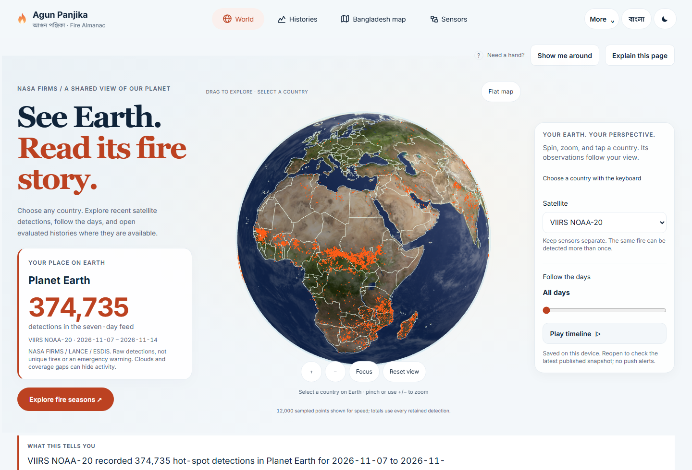

# Agun Panjika: project brief for academic review

**Team KUETaguns · 15 November 2026**

[Live app](https://polymathicx.github.io/Agun-Panjika/) · [Typeset PDF](pdf/PROJECT_BRIEF.pdf) · [29-second demo](https://polymathicx.github.io/Agun-Panjika/demo/) · [Seven slides](pdf/GLOBAL_DEMO_SLIDES.pdf) · [Source](https://github.com/polymathicX/Agun-Panjika)

## The problem and contribution

Satellite hotspot counts are useful, but instruments observe differently. MODIS has roughly 1 km active-fire pixels and VIIRS 375 m pixels. A raw instrument join can introduce a misleading discontinuity. Counts are observations, not unique fires, burned area or a direct measure of human exposure.

Agun Panjika, the Fire Almanac, combines an inspectable sensor correction with a place-based interface. A person can explore recent NASA observations worldwide, then examine a supported historical calendar and compare its reconstruction with withheld VIIRS. Source dates, uncertainty and failure results travel with exports. The project addresses NASA Space Apps' [Harmonization of MODIS and VIIRS Hot Spots](https://www.spaceappschallenge.org/2026/challenges/modis-and-viirs-hot-spots/) challenge.

The existing Bangladesh prototype has been extended with worldwide recent observations, four reproducible annual temporal experiments, a sensor-switch workbench and a mobile PWA. These additions preserve the textured Soft Earth design. They do not establish universal historical accuracy.



## Product and user experience

The entry view is an interactive 3D Earth. A first-visit offer starts an optional eight-step tutorial that teaches actual controls. Skeleton placeholders reserve space, and route/date selections stay consistent while data loads. A user spins, zooms and taps a country; the view animates to the selection and displays recent counts. A daily slider/playback, satellite controls and local watchlist support returning visits. A keyboard country selector and flat-map alternative sit alongside the globe. Reduced-motion settings are respected.

The recent-data viewer covers 242 countries/territories defined by Natural Earth. MODIS, NOAA-20 and NOAA-21 totals remain separate: adding them would double-count repeat observations. Point rendering is capped/sampled, while summary counts use all retained source rows. Generalized boundaries leave some coastal/offshore points unassigned, which are reported separately. Confidence filtering does not remove every industrial source. Each feed retains its own observation window and SHA-256.

The historical workbench contains Bangladesh, Nepal, Chin in Myanmar and Punjab–Haryana in India. Choose a test year and switch week. Compare a raw sensor join, fitted factor and model; reveal the actual VIIRS reference and inspect error/bounds. Changing the switch does not refit the model. Each test year has its own precomputed past-only model. The updated workflow beats a same-workflow fitted factor in these four cases, while Chin’s monthly baseline remains better. A failed future case would still withhold unsupported reconstruction. Raw and comparable-week results remain visible.

The Bangladesh almanac retains history from 2001, five analysis regions, 64 districts, cumulative seasonal comparisons, interactive calendars and sensor/point maps. Local CHT calendars cover 25 upazilas and 124 unions; their early small-area values include apportioned estimates, not independently measured local reconstructions. Cross-border/aerosol and experimental outlook screens remain research views. Expired outlooks are suppressed.

Country summaries export as PNG, source-rich JSON and daily CSV. Historical briefs export PNG/JSON/CSV and browser print/PDF. The installable PWA stores global summaries, historical reference packages and visited country points. Offline information keeps its original date; updates require internet. English/Bangla, themes and mobile layouts remain available. Physical-phone and assistive-technology validation are still needed.

## Sources and processing

| Input | Actual role | Important limit |
| --- | --- | --- |
| NASA FIRMS MODIS C6.1; VIIRS S-NPP, NOAA-20, NOAA-21 | Historical reconstruction, successor continuity and recent global observations | Repeated/omitted detections, clouds, overpass differences and industrial heat remain possible |
| NASA POWER | Bangladesh historical weather, FWI and aerosol context | Regional sampled/reanalysis context, not local station measurements |
| ESA Fire_cci / CEDA | Burned-area plausibility cross-check | Different observable; MRBA through 2018 and Sentinel-3 from 2019 introduce a product change |
| geoBoundaries | Country/district/upazila assignment | Boundary versions and small-area allocation affect interpretation |
| Natural Earth 50 m | Worldwide country geometry and point assignment | Generalized boundaries, not jurisdictional precision |
| Open-Meteo; NOAA ONI | Experimental forecast weather / ENSO covariates | No prospective operational skill is established |

The main pipeline ingests observations, normalizes confidence, assigns geography, applies filtering, aggregates ISO weeks, fits models, harmonizes sensors, constructs calendars/seasonal normals and exports static data. Shared successor rules apply monthly correction and source availability consistently in national, local and neighbour series. Actual zero remains distinct from a missing source; point provenance follows the selected week. S-NPP availability is clamped at the announced retirement date.

Requested API failures raise errors rather than becoming silent zero chunks. Historical aggregation still uses sensor-span coverage assumptions: absence of a detection does not establish a clear-sky observation or complete daily retrieval. The portable experiments avoid learned static-cell filtering, whose independent validation is incomplete.

## Models and evaluation

The portable model is 30% negative-binomial regression and 70% five-seed LightGBM. A strict guard replaces the tree component with a fitted factor only above the pooled training MODIS maximum. This addresses a documented Chin extrapolation failure. Inputs are detector-only; following-week features support retrospective reconstruction, not issue-time forecasting.

For target year Y, fit on 2013 through Y−2 and calibrate intervals on Y−1. The 2022/2023/2024 point fits therefore end in 2020/2021/2022. Calibration has 51/49/50 eligible weeks. Every fit precedes its calibration and target labels. The latest vintage supplies earlier historical estimates; each test-year chart uses its own chronological vintage.

The years were already known during development and several alternatives were explored. This is a known annual walk-forward replay, not an untouched final holdout or unseen-country transfer.

**All 156 original weeks, weekly MAE:**

| Area | Previous release | Updated model | Same-workflow factor | Monthly factors |
| --- | ---: | ---: | ---: | ---: |
| Bangladesh | 45.970 | 46.926 | 58.316 | 49.839 |
| Nepal | 113.001 | 115.232 | 158.516 | 131.390 |
| Chin, Myanmar | 136.414 | 88.530 | 97.283 | 75.525 |
| Punjab & Haryana, India | 313.525 | 246.265 | 262.017 | 291.339 |

Chin improves 35.10% and Punjab–Haryana 21.45% against the previous release. Bangladesh and Nepal are about 2% worse. Chin’s monthly factor still wins; no method is claimed to win every setting or metric.

**Matched comparable reference weeks:**

| Area | Updated model | Fitted factor | Monthly factors | Measured 80% coverage |
| --- | ---: | ---: | ---: | ---: |
| Bangladesh | 51.201 | 63.785 | 54.523 | 78.2% |
| Nepal | 125.792 | 173.297 | 143.696 | 79.6% |
| Chin, Myanmar | 97.198 | 106.860 | 82.957 | 74.6% |
| Punjab & Haryana, India | 209.497 | 237.311 | 260.711 | 82.4% |

NASA documents a 2–6 November 2024 GPS acquisition outage during a major Punjab error. Raw timestamps corroborate missing S-NPP observations. A globally fixed long-outage rule flags 14 test weeks, equally for every area and baseline. All raw counts and 156-week scores remain available. The comparable 142-week scores correct reference quality; they are not advertised as prediction improvements. Totals over eligible weeks are not complete annual totals.

The app marks incomplete references as gaps. Its measured nominal-80% interval coverage ranges from 74.6% to 82.4%; 49–51 calibration weeks provide limited evidence, not a guarantee. The [model card](GLOBAL_EVALUATION.md) includes source hashes, guard usage, every baseline, per-year/regional results, original benchmark links and reproduction. The [research note](MODEL_OPTIMIZATION_RESEARCH.md) preserves failed alternatives.

```powershell
python -m pip install -e ".[dev]"
python -m pipeline.global_cases --from-packages
```

Public feature inputs and the NASA quality manifest refit the workflow without a key. They do not independently audit the raw-to-feature preparation; library/platform variation is possible. The older weather-assisted Bangladesh LOYO audit remains separate.


## Architecture and maintenance

The frontend is static React/TypeScript with Three.js, D3 and MapLibre. There is no application database or backend. Python prepares versioned JSON, GeoJSON and feature fixtures. GitHub Pages serves the build; a six-hour workflow refreshes public global feeds separately from heavy scientific regeneration. The global refresh/deploy has succeeded in hosted CI. The full heavier Bangladesh science path is not claimed as reverified in hosted CI.

The browser has no FIRMS key. A local watchlist remains on the device. Runtime dependency notices are generated at build time. Original code has an Apache 2.0 license; credited imagery, geography and libraries retain their own terms. [Verification](VERIFICATION.md) documents executed tests and their limits.

## Intended impact and next evidence

A student can investigate observations in their own country; a community group can share a dated brief; a researcher or land manager can inspect seasonal patterns and sensor discontinuities. Those are supported tasks, not measured adoption or prevention outcomes. No completed practitioner pilot, agency partnership, lives saved or fires prevented is claimed.

The most useful academic contribution now is to agree on a new locked evaluation, review feature/filter independence and interval calibration, and recruit a small comprehension/practitioner study. Operational forecasts require archived issue-time weather and prospective evaluation. Arbitrary polygon reconstruction requires scale-specific validation; it cannot be justified by adding a drawing control. [Delivered roadmap and research gates](GLOBAL_EXTENSION_PLAN.md).

## Team and review materials

Sohaib Hasan Niloy (Team Owner), Ayesha Mehereen, Sarwad Hasan Siddiqui, Adiba Tahsin, Abdullah Al Saif and Md. Rafsani Shazid. Team KUETaguns, Bangladesh.

Send the mentor the project-brief PDF, global-roadmap PDF and live app; the seven-slide deck is a quick introduction. [Mentor reading guide](MENTOR_BRIEFING.md) lists focused review questions. [Sources](SOURCES_AND_SUBMISSION.md) and [AI disclosure](DATA_AND_AI_DISCLOSURE.md) cover NASA data, third-party resources and assistance. The team must review and perform the official submission itself.
