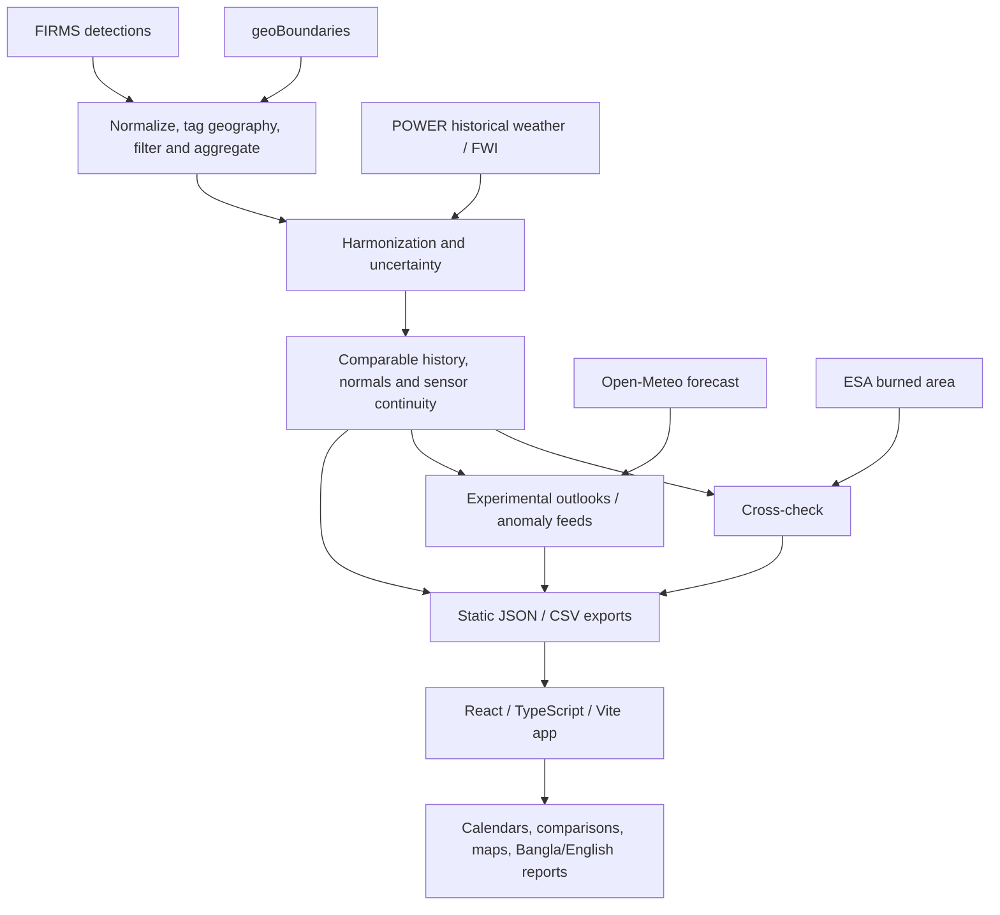

# Agun Panjika: project brief for academic review

**Team KUETaguns · Khulna University of Engineering & Technology (KUET), Bangladesh** 
NASA Space Apps Challenge 2026 · Harmonization of MODIS and VIIRS Hot Spots 
Documentation reviewed: **29 October 2026**. Scientific results are from the committed exports generated on 10 October; they have not been re-estimated for this brief.

[Project video](https://youtu.be/9FMIzcXhqB4) · [Repository](https://github.com/polymathicX/Agun-Panjika) · [Global extension proposal](GLOBAL_EXTENSION_PLAN.md) · [Scientific review](SCIENTIFIC_REVIEW.md)

## Abstract

Agun Panjika (আগুন পঞ্জিকা, Fire Almanac) is a bilingual web application and Python pipeline for comparing Bangladesh's satellite-detected fire activity across changes in observing instruments. MODIS and VIIRS have different spatial resolution and detection characteristics; a raw joined series can therefore confuse sensor changes with changes in burning. The pipeline reconstructs earlier weekly activity on a VIIRS S-NPP detection scale, retains observed-versus-estimated provenance, and provides calendars, seasonal comparisons and uncertainty. Its committed internal leave-one-year-out evaluation over 2012–2025 reports national weekly mean absolute error (MAE) of 36.964 detections, versus 49.450 for a fitted single-factor baseline. The application covers five analysis regions and 64 districts, with local calendars for 25 upazilas and 124 unions in the Chittagong Hill Tracts. Current evidence establishes a working prototype and an internal reconstruction benchmark. Independent temporal/geographic validation, prospective forecast evaluation and user studies remain necessary before stronger scientific or operational claims.

## 1. Problem and intended use

The question the application helps a user investigate is **“Is this fire season normal for this area?”** Answering it requires a record in which sensor sensitivity does not dominate the comparison. NASA FIRMS provides MODIS active-fire layers at approximately 1 km and VIIRS layers at 375 m; these are observation resolutions, not the dimensions or number of individual fires. [NASA FIRMS documentation](https://firms.modaps.eosdis.nasa.gov/mapserver/wms-info/)

Bangladesh is the initial case study, with particular attention to the Chittagong Hill Tracts. Intended users include forest officers, local communities, researchers and newsrooms. One concrete workflow is to select Bandarban, compare a season's cumulative activity with historical normals, inspect the calendar and map, and share a dated Bangla report. These are intended uses; completed field adoption or prevention benefits have not been established.

## 2. Contribution and research positioning

The implemented contribution is a reproducible combination of regional sensor harmonization, uncertainty-aware historical reconstruction, continuity checks and a bilingual calendar/reporting interface. The models themselves are established statistical and machine-learning approaches. This project does not claim to invent negative-binomial regression, boosted trees, conformal calibration or satellite-fire harmonization.

The question for further research is whether this particular combination improves comparability and interpretation under independently tested temporal and geographic changes. A formal related-work comparison, ablations and stronger independent evaluation are proposed work. Bangladesh fire-season research, including [Farukh, Islam and Hayasaka (2023)](https://www.mdpi.com/2073-4433/14/1/97), supplies domain context; its findings are not the validation results of this application.

## 3. Data, geography and current snapshot

| Input | Role | Important qualification |
| --- | --- | --- |
| NASA FIRMS MODIS Terra/Aqua and VIIRS S-NPP/NOAA-20/NOAA-21 | Active-fire observations, reconstruction reference and successor continuity | A detection is not a unique fire; repeated observations and detection omissions remain possible |
| NASA POWER | Historical weather, FWI inputs and aerosol context | Regional sampled/reanalysis context, not local station observations |
| Open-Meteo | Forecast weather for the danger outlook | Actual forecast quality was not established by the perfect-weather experiment |
| geoBoundaries | Administrative tagging and maps | Boundary version and snapping matter; local exports use older administrative definitions |
| ESA Fire_cci | Burned-area cross-check | Different observable; MRBA v6.0 before 2019 and Sentinel-3 SYN v1.1 afterward |
| NOAA CPC ONI | Experimental ENSO covariate | Testing an input does not mean it improved the final outlook |

Source links and credits: [sources and submission notes](SOURCES_AND_SUBMISSION.md). Machine-readable snapshot: [manifest](../web/public/data/manifest.json).

The national export contains 1,345 ISO weeks from 2001-W01 through 2026-W41: 576 estimated and 769 observed, with no successor-bridged weeks yet in that saved record. Sensor observations end on **9 October 2026**. The normal baseline is 2003–2025. Current weather/outlook exports were generated on 10 October; the saved fire-weather forecast ends on 25 October. Those products are archived examples as of this documentation date.

The five analysis regions are Rangamati, Khagrachhari, Bandarban, Chattogram/Cox's Bazar hills, and the rest of Bangladesh. Local calendars cover the three CHT districts: 10/51 upazilas/unions in Rangamati, 8/41 in Khagrachhari and 7/32 in Bandarban. Historical local estimates are apportioned from larger-area records; these are not independently fitted local forecasts. All union names still require full Bangla localization and community review.

## 4. Method

### 4.1 Cleaning and aggregation

The pipeline normalizes FIRMS metadata, removes exact duplicates, tags geography, applies confidence/type rules and identifies probable static heat sources. It retains MODIS confidence at least 30% and VIIRS nominal/high observations, excludes FIRMS static-land/offshore types, and uses persistence/day-night/seasonality heuristics for industrial heat cells. District-week counts, fire radiative power and composition/geometry features are aggregated to regions and the nation. [Ingestion](../pipeline/ingest.py) · [static-source filter](../pipeline/kilns.py) · [aggregation](../pipeline/aggregate.py)

The static filter is a heuristic, not a certified kiln inventory. The final manual inspection round recorded 16 positive industrial labels among 20 sampled cells, after earlier tuning rounds; it is not an independent large-sample estimate of precision or recall. Missing sensor coverage and zero fire activity also need stronger separation in aggregation.

### 4.2 Harmonization

During the 2012–2025 overlap, the target is regional weekly S-NPP detections. A negative-binomial model relates counts to MODIS count/FRP with regional and seasonal intercepts. Bagged Poisson LightGBM models also use sensor composition, neighbouring-week counts, cloud/weather/FWI and viewing geometry. The shipped point estimate combines **30% negative binomial and 70% average of five LightGBM seeds**. [Model implementation](../pipeline/harmonise.py) · [configuration](../pipeline/config.py)

$$
\widehat{V}_{r,w}=0.30\,\widehat{V}_{\mathrm{NB},r,w}
+0.70\,\frac{1}{5}\sum_{s=1}^{5}\widehat{V}_{\mathrm{GBM},s,r,w}.
$$

Here, V denotes weekly detections on the S-NPP reference scale, r the region and w the week. The full model reconstructs the MODIS-only period; a separate lower-confidence Terra-only model covers 2001 through 2002-W26. Some features include next-week MODIS counts, making this a retrospective reconstruction method rather than an issue-time forecasting algorithm.

### 4.3 Uncertainty and continuity

Nominal 80% intervals use held-out log-error distributions grouped by activity/season, with separate annual-error treatment. The current reported coverage evaluation is not strictly nested: some calibration residuals can come from models whose training included the evaluation year. A fully separated calibration and final assessment are priority research tasks. [Coverage implementation](../pipeline/harmonise.py#L495)

Successor comparisons test identity, a fitted factor and shrunk monthly factors against overlapping S-NPP observations. Both successors currently select identity. Main/local/neighbour/point exports need more handover and missing-data consistency tests, especially if nonidentity corrections are selected later. [Bridge](../pipeline/bridge.py) · [detailed audit](SCIENTIFIC_REVIEW.md#important-limitations-and-improvement-opportunities)

### 4.4 Normals, outlooks and cross-checks

Season status compares cumulative activity with the area's complete-year historical baseline, excluding the displayed year. Two-week national/regional outlooks combine fire history and weather features; district anomaly feeds flag unusual observed activity. ESA burned area tests agreement in annual/seasonal variability. Cross-border charts compare CHT and neighbouring areas, and upwind burning with Dhaka aerosol context; they do not implement causal smoke transport. [Normals](../pipeline/climatology.py) · [outlooks](../pipeline/forecast.py) · [ESA check](../pipeline/partner.py) · [neighbours](../pipeline/neighbours.py)

## 5. Results and what they establish

### 5.1 Internal reconstruction benchmark

The committed evaluation leaves out one overlap year at a time and compares national weekly predictions with S-NPP. Values below are averages across the held-out years, not a new experiment run for this document.

| Method | Weekly MAE | Off-season weekly MAE | Mean absolute annual-total error |
| --- | ---: | ---: | ---: |
| Fixed 4.4× factor | 60.971 | 26.095 | 20.150% |
| Factor fitted within each fold | 49.450 | 28.705 | 12.785% |
| Monthly factors | 43.180 | 21.933 | 11.888% |
| Negative binomial | 44.110 | 19.458 | 9.652% |
| Bagged LightGBM | 38.684 | 15.347 | 10.426% |
| Shipped ensemble | **36.964** | 15.861 | **9.501%** |

The ensemble's weekly MAE is 25.25% lower than the fitted factor and 39.37% lower than fixed 4.4×. It beats the fitted factor in all 14 evaluated off-seasons, although LightGBM alone has the lower overall off-season MAE. These results do not establish that the ensemble wins every region, year or metric. [Validation JSON](../web/public/data/validation.json)

Reported interval coverage is 80.1% region-week, 81.3% national-week and 85.7% national-year, for an 80% target. Median national-week interval width is 1.39 times the point estimate. Broad intervals and the calibration-independence issue should remain visible when presenting performance.

### 5.2 Independent observable and successor comparisons

The saved ESA transition diagnostic is 0.95 for harmonized counts versus 3.09 for a raw stitched record. The estimated-years log-annual correlation is 0.93 and seasonal-cycle correlation 0.98. Burned area and active-fire counts measure different phenomena; their agreement supports plausibility rather than ground-truth accuracy. The ESA product change in 2019 is an additional source of comparability uncertainty. [Partner JSON](../web/public/data/partner.json)

Mean absolute held-out total error for the selected identity bridge is 4.58% for NOAA-20 and 10.79% for NOAA-21. The NOAA-21 overlap is shorter and includes partial years, so these scores should not be treated as equally strong evidence. [Bridge JSON](../web/public/data/bridge.json)

### 5.3 Experimental forecasting

| Two-week hindcast setting | Brier skill versus climatology | ROC AUC |
| --- | ---: | ---: |
| Fire history only | 0.110 | 0.708 |
| Fire history plus observed future FWI | 0.213 | 0.768 |

The second row uses future observed weather as an optimistic experiment. It does not measure the accuracy of a real forecast feed. End-to-end time separation, actual issue-time forecasts and independent interval calibration remain unestablished. The remainder-of-season product reports `has_skill=false`; the interface presents the normal range. [Forecast JSON](../web/public/data/forecast.json)

## 6. Product and software architecture

There is no application backend or database. Python prepares static exports, and React consumes them through validated asynchronous requests. D3 powers charts and the interactive Canvas fallback; MapLibre powers the map. The restored Soft Earth homepage uses a lazy Three.js globe with licensed static Earth/cloud textures, linked geographic controls and an interactive 2D fallback when WebGL or textures are unavailable. The blue/cream layout and coral accents preserve the saved Soft Earth design.

The current seven routes are Overview, Calendar, Sensors, Map, Outlook, Borders and Method. Implemented interface work includes shared URL/filter/history state, a bilingual guided demo, keyboard/table alternatives, mobile layouts, loading/error/retry handling, export feedback and cached offline resources. Offline access requires prior same-origin caching; external tiles/fonts are outside that guarantee. [Current screenshots and provenance](review/README.md)

## 7. Reproducibility and verification

Start with [the README's local commands](../README.md#getting-started). Existing exports are sufficient for interface review. For scientific regeneration, install the Python package, obtain any needed FIRMS API key, and use `python -m pipeline.run_all --help` before running downloads/model fitting. The key belongs only in the gitignored pipeline environment.

The 29 October check passed all 59 Python tests, TypeScript checking, the production build, and eleven production browser test groups. The 42-view matrix recorded zero page errors, console errors, overflow or axe findings in those runs. This establishes behavior under the tested setup, not a physical-device accessibility certification, a new model-training result or field effectiveness. [Verification report](VERIFICATION.md) · [machine-readable evidence](review/verification-2026-10-29.json)

Review charts can be reproduced solely from committed JSON with `python notebooks/review_figures.py` after installing matplotlib. PNG, editable SVG and vector PDF exports are included. The generator does not download data or retrain models.

## 8. Limitations and research priorities

- **Independent evaluation:** audit feature/model selection, static filtering, reconstruction preprocessing and calibration within temporal splits; reserve an untouched final evaluation.
- **Operational availability:** incorporate source latency, coverage gaps, freshness and archived issue-time weather. Separate retrospective reconstruction from forecasts.
- **Spatial validity:** district/local apportionment is not independent small-area calibration. Arbitrary polygons and worldwide accuracy are not supported by the current interface alone.
- **Handover:** exercise missing-sensor and transition cases across every export product, including nonidentity factors and bridge uncertainty.
- **Impact and language:** the five-person study sheet is blank. Native Bangla/CHT review, user comprehension and stakeholder workflow fit remain proposed work.
- **Release:** no working public demo was verified during the review; hosted refresh had failed. Dependency advisories, source licensing and method-copy drift remain documented follow-up work.

Source locations and failure modes: [scientific review](SCIENTIFIC_REVIEW.md). Proposed interventions and exit criteria: [global extension plan](GLOBAL_EXTENSION_PLAN.md).

## 9. Where academic mentorship would help

| Question | Requested guidance | Tangible next artifact |
| --- | --- | --- |
| Is the evaluation independent enough? | Temporal splits, nested calibration, model selection and leakage review | Agreed evaluation protocol and locked holdout |
| What is the defensible contribution? | Related-work positioning and fair baselines | Contribution statement, comparison matrix and ablation plan |
| Does it transfer? | Selection of contrasting geographic cases and failure criteria | Reproducible second-country case with all scores reported |
| Does the interface help its users? | Practitioner introductions, language review and study design | Completed pilot, comprehension results and product revisions |
| Could it support a paper? | An appropriate research question and evidence standard | Research outline after the missing experiments, without assuming publishability |

## 10. Claim-to-evidence and academic self-review

| Claim | Evidence | Assessment |
| --- | --- | --- |
| A functioning bilingual prototype exists | Current source, production screenshots and test results | Supported in tested local environment |
| Internal reconstruction improves on a fitted factor | `validation.json`, 2012–2025 comparison | Supported as an internal benchmark; independent confirmation needed |
| Sensor continuity is more plausible than raw stitching | `partner.json` and successor comparisons | Supported as limited aggregate diagnostics |
| Uncertainty is guaranteed or independently nested | Current calibration/coverage code | Not established; revise evaluation |
| Forecasts prevent fires or are operationally validated | No prospective field evaluation | Not established |
| The method works globally | Country configuration and limited prior examples | Not established; proposed experiments |
| Users can correctly interpret it | Uncompleted user protocol | Needs new study |

The contribution is described as a system and evaluation problem, not a new foundational algorithm. The method, metrics and source dates are explicit. Experimental strength needs independent holdouts, ablations and transfer cases; evaluation completeness needs prospective forecasting and user evidence; method soundness needs stricter time/coverage controls. These open questions are the intended starting point for academic discussion.
