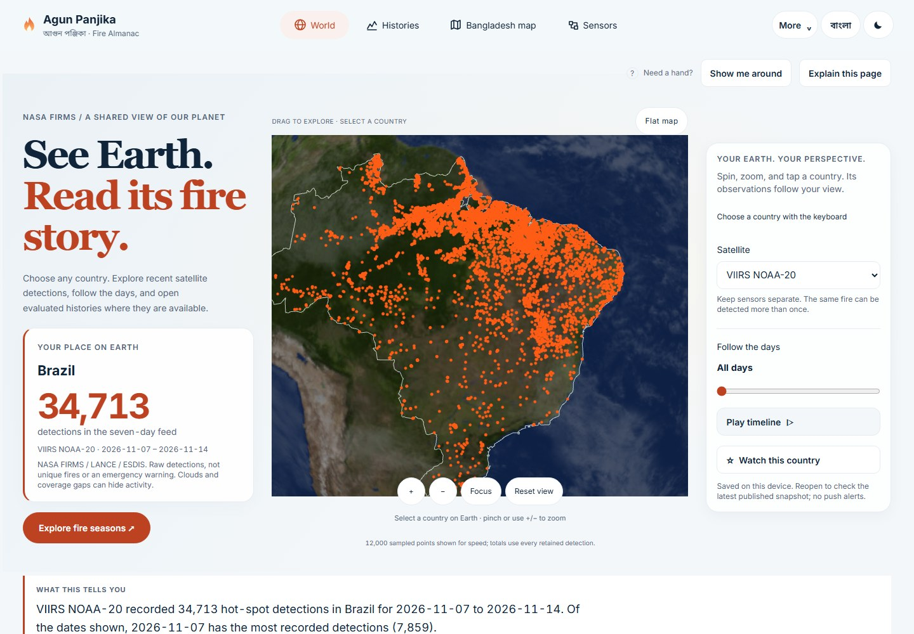

# Using Agun Panjika

**15 November 2026** · [Open the app](https://polymathicx.github.io/Agun-Panjika/) · [Visual overview](../README.md) · [All documentation](README.md)

Agun Panjika helps you explore recent satellite observations and compare fire seasons. Begin with a place you care about. You can use the site without an account or installation.

## Your first visit

Choose **Show me around** for an optional eight-step introduction. It follows actual actions: selecting a country, choosing a satellite/day, saving a place, exploring a historical case, revealing observations and keeping a brief. Use Back, skip a step, exit or replay. Leaving restores the view and filters you started with.

For a specific question, open **Explain this page**. Its page and topic selectors let you jump directly to any of 85 topics across all nine pages. Help highlights the actual control, keeps it usable and can be closed/reopened whenever needed. Escape closes help. English/Bangla, visible keyboard focus and phone layouts are supported.

## Explore recent observations worldwide

1. Open **World**. Drag to turn Earth; pinch, scroll or use the zoom buttons. Tap/click a country. **Focus** moves to the selection; **Reset view** returns to the wider Earth.
2. For keyboard access, open **Choose a country with the keyboard**. A **Flat map** offers another geographic view.
3. Choose MODIS, VIIRS NOAA-20 or VIIRS NOAA-21. Read that source's count and observation dates together. Each feed has its own window.
4. Move **Follow the days** or choose a daily bar. **Play timeline** steps through available days. Pause to inspect one date; **All days** covers the displayed feed window.
5. Read **What this tells you** for a short explanation of your selection. **How to read this** shows its calculation basis and limits.
6. Choose **Watch this country** to save it on this device. Reopen the saved country when you return. It is a local bookmark, with no account or push-alert delivery.
7. Use the report's export controls for a PNG, JSON or daily CSV. The dates and source travel with the brief. Copy the URL to preserve a selection for someone else.

The Earth displays sampled points for performance. Counts use all retained detections, including those not drawn. Generalized country boundaries can leave coastal/offshore points unassigned; summary metadata records them. A zero count means no retained detections in that source/window, while a missing source is reported separately.

## Explore a historical comparison

Open **Histories** and choose Bangladesh, Nepal, Chin in Myanmar, or Punjab–Haryana in India. These four areas have evaluated reconstruction packages. Worldwide recent observations are available more broadly.

Choose a **Test year** and move **Switch at week**. Before the switch, the connected record estimates activity from MODIS on a VIIRS S-NPP detection scale; afterward it uses VIIRS observations. **Reveal actual VIIRS** adds the reference so you can inspect agreement. It reveals precomputed evidence; moving the switch does not train a new model.

Read the legend: raw join, fitted factor, corrected join and actual VIIRS are separate series. Shading is the calibrated nominal-80% interval. Incomplete reference weeks appear as gaps. The comparison table and **What this tells you** follow the selected year and comparable weeks. Raw references and source-quality flags remain in downloads.

Explore the longer calendar, open chart tables, inspect methodology and export PNG/JSON/CSV or use browser print/PDF. For the complete numerical protocol and every baseline, use the [model card](GLOBAL_EVALUATION.md).

## The Bangladesh almanac and research views

The main navigation opens World, Histories, Bangladesh map and Sensors. **More** contains the other views. A changed year, week or region is kept in the URL where supported.

| View | What to try | How to interpret it |
| --- | --- | --- |
| Season report | Choose region, year and week; inspect seasonal curves and weekly readings | Historical activity/seasonal context; keep observations and estimates distinct |
| Fire calendar | Choose a region/year and inspect a week with pointer or keyboard | Weekly color patterns with numerical/table alternatives; a color is not an emergency alert |
| Bangladesh map | Select a week/district, inspect points and geographic context | Points carry the selected week's source; early small-area values can be apportioned estimates |
| Sensors | Toggle series, change the period and inspect the overlap/ratio | Different instruments have different sensitivity; raw counts are not directly interchangeable |
| Outlook | Read validity dates, intervals, weather context and skill | Experimental research estimates. Expired predictions are withheld; prospective warning skill is unestablished |
| Borders | Choose a year and compare neighbouring seasonal timing/aerosol context | Co-occurrence can prompt investigation; it does not establish pollution transport or causation |
| Method | Read processing, assumptions, sources and download links | Entry point for checking the evidence and reproducing the work |

Use **Explain this page** for the details of each individual control, chart, table and download. [Screenshots of every view](gallery/README.md).

## Language, motion and phone access

Use **বাংলা / English** to change language, and the theme control for light/dark appearance. The app respects your reduced-motion preference. Charts have table alternatives; the geographic views have keyboard controls/fallbacks.

To install, open the live HTTPS site in a supported browser and use its install prompt or browser menu. On iPhone, use Safari's share menu and **Add to Home Screen**, then enable **Open as Web App** if that option appears. [Apple's installation steps](https://support.apple.com/guide/iphone/open-as-web-app-iphea86e5236/ios). The exact label depends on the browser. Installation adds a shortcut/app window; the ordinary website remains usable.

Let a connected visit finish loading first. The PWA caches the shell, world summaries and historical reference packages. Country-point files are cached when visited. Offline pages retain the original source date. New observations and external map tiles need a connection. Reconnect to check for a newer published snapshot; the data does not update while the phone is offline.

Your watchlist and tutorial progress stay in local browser storage. Clearing site data removes those choices and cached files. No account, cloud sync or notification subscription is created.

## Reading and sharing responsibly

Satellite detections are heat observations, not unique fire incidents, burned area, exposure estimates or a declaration that a place is safe. Clouds, overpass timing, missed observations and industrial heat affect the record. The app is for exploration and research; use your local emergency services and official warnings for urgent decisions.

The plain readings use fixed calculations from displayed data. They keep missing data, actual zeros, reference quality and forecast expiry distinct. They do not rely on an external AI service. Open the basis/limits alongside a reading when sharing it.

## If a page does not load

Wait for the shaped loading placeholder to resolve. If a request fails, use the displayed retry control. A failed map can be retried while other views remain available. Check your connection before requesting a newer snapshot or uncached country points. A stale-data notice means the dated snapshot is old; it does not turn its counts into current observations.

For a reproducible issue, share the URL, browser/device, selected language/theme and what you expected. Avoid sending secrets. Developers can use the [setup and verification guide](DEVELOPMENT.md).
