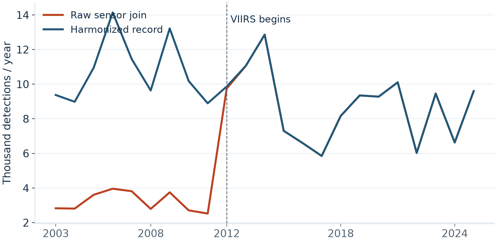

# Visual evidence

Current captures: **14 November 2026**, actual production application. These are browser captures, not generated mockups. Earth/cloud textures provide static geographic context. Snapshot dates belong to the data, not the screenshot creation time.

| View | Capture | What it shows |
| --- | --- | --- |
| Worldwide entry | [Desktop](screenshots/world-hero.png) | Textured interactive Earth, satellite-specific recent counts and source windows |
| Country selection | [Desktop](screenshots/world-country.png) | Brazil selection, country counts and dated reporting controls |
| Historical experiment | [Focused](screenshots/global-experiment.png), [full workbench](screenshots/global-cases.png) | A frozen test-year reconstruction and revealable observed reference |
| Phone | [Globe](screenshots/world-phone.png), [country report](screenshots/world-phone-report.png) | Actual responsive interface and evidence report |

## Publication figures

**Weekly error relative to a training-fitted factor, test 2022–2024.** Bangladesh: 25.34% lower; Nepal: 28.49% lower; Chin: 35.02% higher; Punjab–Haryana: 15.43% higher. Each area has its own fit and 156 test weeks. These are known-period temporal replays, not an untouched holdout or unseen-country transfer. No uncertainty bars are inferred from aggregate scores. [Vector PDF](../latex/figures/global-transfer.pdf) · [Model card](../GLOBAL_EVALUATION.md).

**Bangladesh annual detections, 2003–2025.** The raw join uses MODIS before 2012 and VIIRS thereafter. The harmonized record is on the VIIRS detection scale. The change also contains real annual variation; the illustration does not identify the sensor as the sole cause. Detections are not unique fires. [Vector PDF](../latex/figures/sensor-story.pdf).

Run `python docs/submission/build.py` with a local production preview to regenerate captures, these figures, the slides and video. AI assisted plotting/assembly; values come from project exports. [Build instructions](../submission/README.md).

## Verification and older assets

[Current verification](../VERIFICATION.md) and its machine-readable record describe the checks behind this release. Earlier screenshots and `figures/` retain the 29 October Bangladesh benchmark and ESA cross-check. They remain historical records; their old captions are not the current portable experiment. [29 October machine record](verification-2026-10-29.json).
