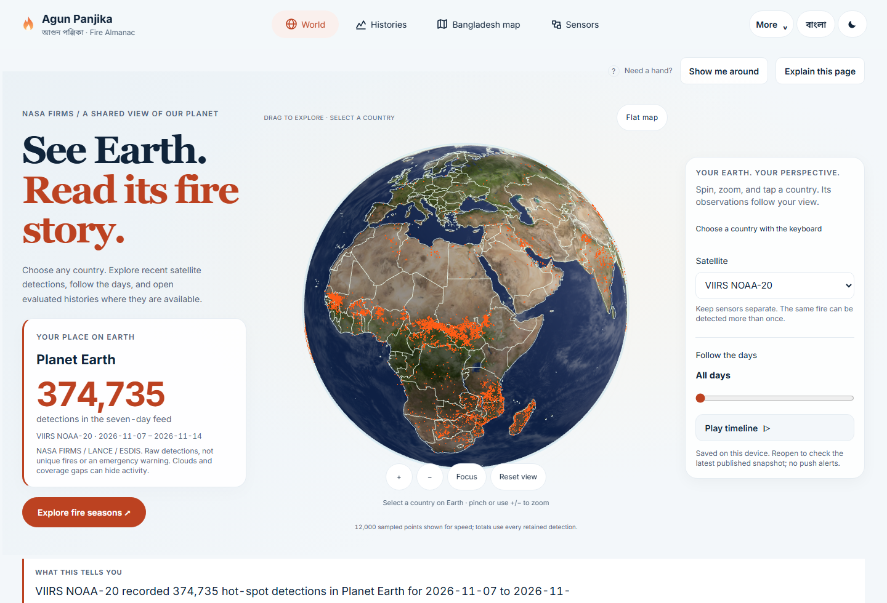
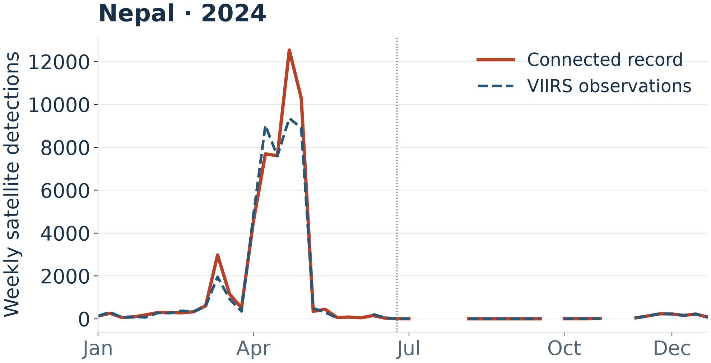

# Product and presentation review

**15 November 2026 | Team KUETaguns**

The public package tells the finished product story. Its seven slides use large type, a satellite pixel-size diagram, actual app captures, a Nepal seasonal figure, a real plain-language reading, and phone help. The 29-second video follows the official introduction, challenge, project, idea and future sequence.

## App views

The current [12-image gallery](../gallery/README.md) covers all nine pages, a selected country and English/Bangla phone layouts. Its [capture metadata](../gallery/captures.json) records source time and route state. The compact JPEGs support GitHub reading; the screenshots below retain the full-resolution presentation assets. [Visual README](../../README.md) · [User guide](../USER_GUIDE.md).

[Selected country](screenshots/world-country.png) · [Historical comparison](screenshots/global-experiment.png) · [Plain reading](screenshots/plain-reading.png) · [Phone](screenshots/world-phone.png) · [On-demand help](screenshots/help-phone.png).

## A seasonal comparison

The connected record uses MODIS-based reconstruction before the selected switch and observed VIIRS afterward. Gaps preserve incomplete references. [Full current-method comparison](../GLOBAL_EVALUATION.md).

## What was checked

The verification record covers responsive routes, real globe interaction, loading/retry behavior, eight-step introduction, 85 on-demand help topics across all nine pages, English/Bangla, data readings, exports and cached offline access. Presentation review checks the seven-page limit, 29-second duration, readable placement and source credits.

The seven-slide [editable PowerPoint](../pptx/GLOBAL_DEMO_SLIDES.pptx) was checked against the source wording and object bounds, then opened/rendered in Microsoft PowerPoint. Native text/shapes remain editable; app views and the seasonal chart are images. Its public download copy is identical. The README gallery script checks real loading/error states and overflow; the five-second recording preview checks duration/frame count and remains below 3 MB.

The [documentation check record](documentation-2026-11-15.json) covers 55 Markdown files, 561 local paths, eight heading anchors, media counts and GitHub Markdown rendering. Actual GitHub diagram/image rendering is also inspected on the documentation branch before merging. Application/model checks are the existing product record, not rerun counts for this documentation refresh.

[Verification](../VERIFICATION.md) · [Teammate video brief](../submission/VIDEO_TEAMMATE_HANDOFF.md) · [Presentation build](../submission/README.md).

Physical devices, practitioner usefulness and a fresh locked scientific evaluation remain separate evidence to collect.
