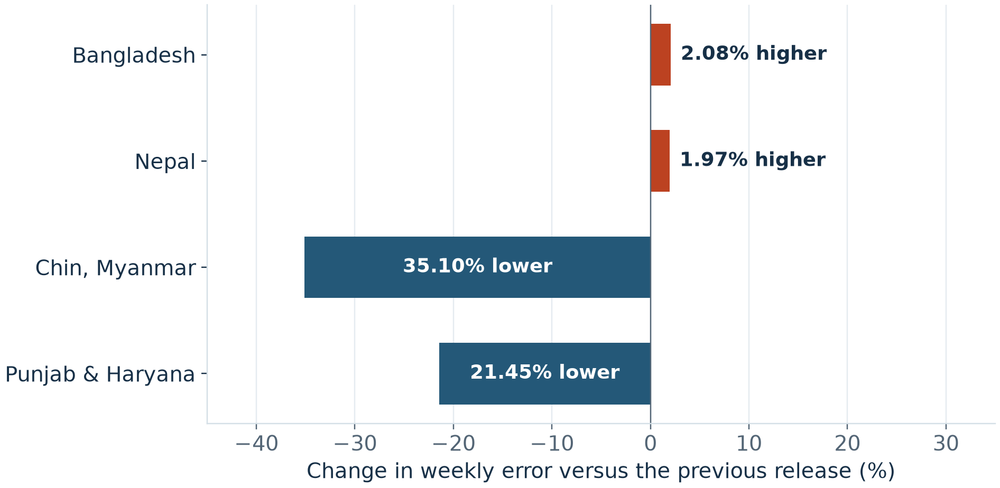

# Application captures and evaluation figures

Current captures: **15 November 2026**, actual production preview. They are browser recordings, not generated mockups. Earth/cloud textures are static geographic context; each data feed has its own observation window.

| View | Capture | What to inspect |
| --- | --- | --- |
| Worldwide entry | [Desktop](screenshots/world-hero.png) | Soft Earth layout, clearer points, satellite counts, source dates and tutorial launch |
| Country | [Brazil](screenshots/world-country.png) | Camera selection, dated country observations and controls |
| Historical experiment | [Focused](screenshots/global-experiment.png), [full view](screenshots/global-cases.png) | Chin 2023, past-only model, revealable reference, quality gaps and stronger baseline |
| Phone | [Globe](screenshots/world-phone.png), [report](screenshots/world-phone-report.png) | Responsive discovery and country evidence |

## Change from the previous release

**Weekly MAE change against the previous release, keeping all 156 original weeks.** Chin improves 35.10%; Punjab–Haryana improves 21.45%. Bangladesh worsens 2.08%; Nepal worsens 1.97%. The new annual workflow fits only older labels and uses a strict tree-support guard. This is a known historical replay, not a fresh holdout. Chin's monthly-factor baseline is still better than the updated model. [Vector PDF](../latex/figures/global-transfer.pdf) · [Complete model card](../GLOBAL_EVALUATION.md).

The app separately reports the same 142 source-comparable weeks for every method. That quality correction does not create the all-week gains above. Raw values, documented outage exclusions and the original frozen benchmark remain accessible.

## Why sensor harmonization matters

**Bangladesh annual detections, 2003–2025.** The raw join uses MODIS before 2012 and VIIRS thereafter; the harmonized line is the separate Bangladesh research record on a VIIRS scale. Real annual variation is present too; the instrument change is not the sole cause. Detections are not unique fires. [Vector PDF](../latex/figures/sensor-story.pdf).

## Reproduction and verification

Run `python docs/submission/build.py` with the production preview to regenerate captures, figures, slides and video. [Build instructions](../submission/README.md). AI assisted coding, plotting and assembly; values are project exports and captures show the real application.

[15 November verification](../VERIFICATION.md) · [machine record](verification-2026-11-15.json) · [Ponytail review](../PONYTAIL_REVIEW_2026-11-15.md). Earlier captures/figures and the [29 October record](verification-2026-10-29.json) remain historical.
